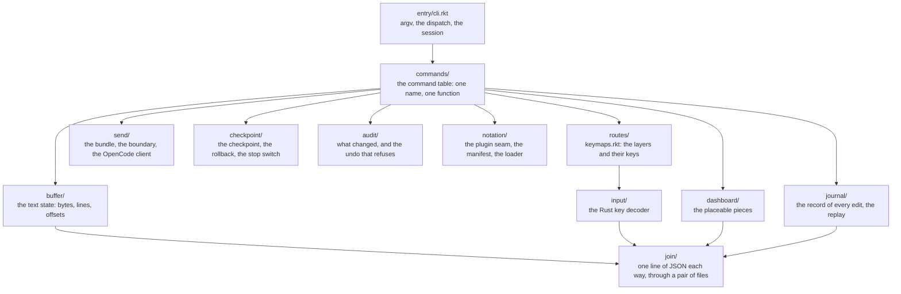

# AIU Editor

The general editor of the AIU ecosystem: a keyboard-driven text editor whose session state
is readable by an AI, whose keymaps are data, and whose one action towards an agent is a
bundle with a reason.

The editor is two halves. The **meaning** is Racket: the commands, the routes, the models,
the rules and the configuration. The **hot path** is Rust: the key decoding, the drawing,
the text state and the journal. They meet in one place, `join/`, and one line of JSON
travels each way.

The editor is driven from a phone, so it binds **no modifier key at all**: no escape, no
meta, no alt, no control. Every key it takes is a key a person can press on its own.

## Purpose and boundaries

This package owns the buffer, the point, the selection, the modes, the command table, the
routing, the journal, the dashboard, the send to an agent, the checkpoint and rollback,
and the plugin seam.

What belongs elsewhere:

- the terminal, the panes and the session belong to the terminal multiplexer;
- the workflow of an AI agent belongs to the agent and its adapter;
- the plugins themselves belong to pm: the editor asks pm and never installs;
- the shared workspace belongs to the `../shared-layers/workspace` package;
- the Git model belongs to the `../shared-layers/git-inspection` package.

The area law binds the package. The areas, lowest first:

`errors`, `narration`, `machine`, `security`, `join`, `devloop`, `journal`, `buffer`,
`notation`, `commands`, `routes`, `input`, `drawing`, `models`, `dashboard`, `send`,
`picker`, `checkpoint`, `audit`, `entry`.

A dependency points downward only, `join/` is the only place Rust and Racket meet, and
the one-way lint and the language-split lint keep every other area clean.

## Current status

| Capability | State |
|---|---|
| The tree, the light gate and the build | Implemented and verified |
| A plain text editing session: open, type, save, through the journal | Implemented and verified |
| The journal and the replay: the state back exactly after a kill | Implemented and verified |
| The routing: which layer sees a key first | In progress: the routes area is built, the walk with the multiplexer in a pane is owed |
| The live session: the keys from the terminal | Implemented and verified |
| The keyboard: the bytes of a key become its name | Implemented and verified |
| The dev mode: work mode, the bake, the last good | Implemented and verified |
| The send: the bundle reaches the agent, the events come back | Implemented and verified; the standing proof is the gate stage against a local stub agent |
| The region: the selection model, and the region in the bundle | Implemented and verified |
| The live audit: what changed, who changed it, the accept, the undo | Implemented and verified |
| The secrets seam: the predicates, the redaction, the no-secrets check | Implemented and verified |
| The kit: the envelope, the capability declaration, the MCP server, the skill, the plugin | Implemented and verified |
| The plugin system: the editor asks pm, loads, refuses by name | Implemented and verified |
| The checkpoint, the rollback and the stop switch | In progress: the area and the send that checkpoints first are done |
| The tasks: declare, list, run, sequence | Implemented and verified |
| The dashboard and the placeable pieces | Implemented and verified |
| The agent opens beside the editor | Planned (TODO item 18) |
| The editor's own keymap explorer | Planned (TODO item 15) |
| The workspace engine joins the editor | Planned (TODO item 20) |
| The Git inspection layer inside the editor | Implemented and verified: the facts and the diff cross the join seam, and the layer only reads |
| The kit conformance across both programs | In progress: the editor's clauses hold, the shared checklist does not close |
| The done line | In progress: the editor's clauses hold, the rest is named and blocked |

The implementation of the editor is paused by the owner (2026-10-21) until the terminal
multiplexer works, because the complete workflow needs it.

## Architecture



The seam is one line of JSON each way, and it travels through a **pair of files**: one for
the request and one for the answer. That is a fact of this Racket build and not a
choice: `racket/system` hands a child `/dev/null` for every stream that is not a file
stream. The decision is D-008 in the root `../DECISIONS.org`.

The areas, one job each:

| Area | What it owns |
|---|---|
| `errors/` | the error record, the one raise, the render |
| `narration/` | the events, the voice, the wait door, the printer |
| `machine/` | the HOME seam, the locks, the cancel door, the terminal |
| `join/` | the wire: the request, the answer, the transport |
| `journal/` | the record of every edit, and the replay |
| `buffer/` | the text state: bytes, lines, offsets |
| `commands/` | the command table: one name, one function |
| `routes/` | the routing: which layer sees a key first |
| `input/` | the Rust key decoder |
| `drawing/` | the Rust drawing of the dashboard |
| `models/` | the models the meaning side answers from |
| `dashboard/` | the status and the context display, as placeable pieces |
| `send/` | the bundle, the boundary, the OpenCode client |
| `notation/` | the plugin seam, the manifest, the pm seam, the loader |
| `checkpoint/` | the checkpoint, the rollback, the stop switch |
| `audit/` | the live audit of what the agent changed |
| `devloop/` | the work mode, the bake, the last good |
| `picker/` | the picker the editor and the browser share |
| `entry/` | argv, the dispatch, the session |

## Implemented capabilities

**The session.** Open a file, edit it, save it, through the journal. The session reads one
command per line from the standard input and prints every answer in the one printer. The
commands are `insert`, `type`, `save`, `show`, `journal`, `replay`, `move-up`,
`move-down`, `move-left`, `move-right`, `delete`, `select`, `send`, `help`, `quit`.

The point is a point in the text, and it moves: `move-left` and `move-right` a character,
`move-up` and `move-down` a line, and `type` puts the text where the point stands. The
journal records the place of every edit, so the state comes back exactly after a kill.

**The journal and the replay.** The state between two commands is the file plus the
journal: the saved text lives in the file, the unsaved work lives in the journal. The
journal sits beside the state, one file per edited file, under
`~/.local/state/aiu-editor/journal/`. A `save` writes the file and empties the journal. A
session killed with `kill -9` mid-edit leaves the edit in the journal, and the next
session on the same file brings the state back exactly.

**The three modes, and no modifier.** The modes are named after what they are for:

| Mode | What it is | The trigger |
|---|---|---|
| `visual` | the general mode: the commands live here | `space` |
| `write` | the text mode: the keys are text | `tab` |
| `select` | the selected text is what the commands act on | `space` |

The write mode is the one place the trigger is not the space, because there a space is a
typed space. Its trigger is the tab, the one plain key that is not text, and a double tab
is the way back to the visual mode. The trigger pressed twice is the mode change, so the
mode changes with a double space and never with a modifier.

In the visual mode: `space space` to the write mode, `space w` to the write mode,
`space v` to the select mode, `space s` to save, `space q` to quit, `space l` to show the
state of the file, `space ?` for help, `space g` to send what is selected to the agent, the
arrows to move the point, and `backspace` to delete. In the write mode the keys are the
text you type, with `tab s` to save, `tab q` to quit and `tab v` to go back to the visual
mode. The tables are data, in `editor/src/routes/keymaps.rkt`, so what the editor does
with a key can be read without reading a function.

**The routing.** The keyboard layer owns the routes, and the shape is the contract's: the
focused program sees a key first, then the editor's own layers, and the multiplexer's
reserved prefix applies everywhere. No layer of the editor may bind the reserved prefix
`C-b`.

**The live session.** When the input is a terminal the editor is the real editor: the keys
are read one at a time, each one routed and run. When the input is a pipe it stays the
scripted session, one command per line, so every proof that drives the editor with a pipe
keeps working. The terminal is put in raw mode, and the settings that were found are saved
first, so the terminal is given back exactly as it was found even when the editor is
killed. There is **no timer anywhere**: a read waits for the next byte, and a key that
starts a sequence waits for the next key. A key that means nothing to anybody is said out
loud.

**The keyboard.** The decoding is Rust (the `input/` area) and the keymaps and the meaning
stay in Racket (the `routes/` area), as decision D-007 says. The kitty keyboard protocol
is adopted, not invented: the flags that ask the terminal to report the escape codes it
would otherwise swallow are the protocol's own, and the reader uses no timer of its own. A
lone escape is the escape key, and the next byte decides it.

**The dev mode.** The program runs in one of two modes, chosen by the owner and read once
at the start; there is no watcher, no poll and no timer. The **work mode** loads the
config live from the source, so an edit to the source is seen at the next start. The
**bake** makes the config into first-class defaults in a generated module, and it keeps
the result only when the check says yes: a bake that is not good never ships, the last
good stays the last good, and the bad one is kept beside it to look at. The baked mode is
chosen with `AIU_EDITOR_MODE=baked`; anything else is the work mode. The measured start
is printed with the first answer, and it is information, not a gate.

**The send.** The editor's one action towards an agent is to build a bundle and call the
boundary. The bundle carries the contract's shape and no agent-specific key and no secret:
the adapter translates, and the program never learns which agent answers. The **why is
mandatory**: a send without a reason is refused, because a send nobody can explain is a
send that cannot be audited. The bundle is the contract's shape, and it is the same shape
the multiplexer sends:

```
boundary: 1  program: aiu-editor  project: aiu-ecosystem  target: opencode
why: checking the send shape
position: 0
selection:
```

The boundary is one way: open or attach a session, send a bundle, subscribe to the events,
answer a permission ask, cancel, end. It reports two pins, the boundary version it
implements and the agent version it was verified against, and there is **no silent
downgrade**: what the agent cannot do today, the adapter refuses by name. The boundary is
one-sided until an agent is attached, and it says so rather than pretending.

**The checkpoint, the rollback and the stop switch.** A checkpoint is made **before an
agent acts**; that is the whole point of it. The files are added one by one, never a
blanket add, and the commit's note names the files that were not tracked, so nothing is
lost silently. A **send makes its own checkpoint first**, so no bundle ever leaves without
one. The rollback puts the tree back and never guesses: a commit that is not there is
refused by name. The stop switch is coarse (decision D-010): it stops every agent session
for this project, with no per-session and no per-agent toggle. It is a file in the state
directory, and the adapter asks it on every call; a call is an action, and nothing polls
in a loop.

**The live audit.** What changed in the tree, who changed it, the accept, and the undo
that refuses by name when the file changed again.

**The secrets seam.** Total predicates, the redaction, and a no-secrets check that runs on
a real bundle and on disk. The secret words are `api_key`, `api-key`, `apikey`,
`password`, `passwd`, `secret`, `token`, `authorization`, `sk-`, `bearer ` and
`-----begin`; the value is cut at the first `:` or `=`, whichever comes earlier.

**The tasks.** A task is a plain function on the meaning side: it takes the session and
the string arguments, and answers one line. Its doc line is the comment block above its
own definition, so the list and the help come from the source and never from a second
list. `--dry-run` opens the scope where a task that acts prints what it would do and
changes nothing. A name the table does not hold is refused by name, never guessed at.

**The dashboard.** The status and the context display. The placement is **data**: a piece
names an edge, a width and an order, so any piece can go on any edge and several pieces
can share one. A piece is never cut: a piece whose text needs more room than its size
says gets the room it needs.

**The Git facts.** The editor asks the shared Git layer about the file's own
directory, over the join seam: the hot path asks the layer, and the facts cross as
names and values — the repository, the branch, the distance from the upstream, the
counts of staged, unstaged, untracked and conflicted files, the freshness, and the
file's own state in the index and in the working tree, which are two different states.
The layer only reads: no repository, index, branch or worktree is changed, and the
editor's buffer is never saved to find out. A file that is not inside a repository is
refused by name.

```
$ racket editor/src/entry/cli.rkt git ../README.md
git-branch: main
git-conflicts: 0
git-divergence: in step with the upstream
git-file: universe/.../AIU-ECOSYSTEM/README.md
git-file-index: unchanged
git-file-working: clean
git-freshness: fresh
git-repository: /root/home/shape/Subnet
git-staged: 0
git-unstaged: 6
git-untracked: 1
```

**The diff of a file.** The editor asks the same layer for the diff, and the answer
names the comparison, so the working tree against the index and the index against HEAD
are never shown as one thing. The hunks say where they are on both sides, and the lines
that changed carry the layer's marks: `+` for an added line, `-` for a removed one, and a
space for a context line.

```
$ racket editor/src/entry/cli.rkt git-diff editor/src/entry/dispatch.rkt
the comparison: working tree against index
the file: universe/.../AIU EDITOR/editor/src/entry/dispatch.rkt
the hunks: 2
@@ -356,1 +356,27 @@
-;; edit-file opens the file the user named and runs the editing session.
+;; git-diff-verb asks what Git says differs in the file, and prints the
...
```

**The plugin system.** A plugin is a package with a manifest. pm owns the package; the
editor owns how it talks to it, and the editor **never installs anything by itself**: it
asks pm, and pm's rule is the editor's rule. The verbs are `plugin`, `plugin-register`,
`plugin-install` and `plugin-call`.

## Public interface

The CLI:

```bash
racket editor/src/entry/cli.rkt edit FILE       # a session, one command per line
racket editor/src/entry/cli.rkt routes          # the routing walk
racket editor/src/entry/cli.rkt keys LAYER HEX… # the name of each key
racket editor/src/entry/cli.rkt dashboard FILE   # the dashboard, one line per row
racket editor/src/entry/cli.rkt git FILE          # the Git facts of the file
racket editor/src/entry/cli.rkt git-diff FILE     # the hunks of the file, and the comparison they are
racket editor/src/entry/cli.rkt tasks           # the task table
racket editor/src/entry/cli.rkt task FILE NAME WORDS…
racket editor/src/entry/cli.rkt task --dry-run FILE NAME WORDS...
racket editor/src/entry/cli.rkt send FILE TARGET WHY…
racket editor/src/entry/cli.rkt agent            # the agent's session
racket editor/src/entry/cli.rkt permit once REQUEST-ID
racket editor/src/entry/cli.rkt checkpoint TREE WHY…
racket editor/src/entry/cli.rkt rollback TREE COMMIT
racket editor/src/entry/cli.rkt stop stop|start
racket editor/src/entry/cli.rkt bake
```

The path must be **relative**: the project directory holds a space, and `racket` splits a
path that holds one.

The session's answers are one line each. The numbers are the bytes and the lines of the
text, and `pending` is the records in the journal, the edits that are not saved yet:

```
bytes=30 file=/tmp/readme-demo.txt lines=1 pending=0
```

The agent seam is configured through the environment: `AIU_AGENT_URL`, `AIU_AGENT_USER`,
`AIU_AGENT_PASSWORD` and `AIU_AGENT_DIRECTORY`. The server prints a fresh password when it
starts. The session is opened with every mutating action at `ask`, so the agent's write
comes back as a permission ask and nothing lands until the human answers.

## How it works

1. `entry/` reads argv and dispatches. A session opens the file, asks the Rust side for
   the text, and holds the session state.
2. A key arrives at the Rust decoder, which names it, and the Racket side routes it: the
   focused program first, then the editor's layers, and the reserved prefix belongs to the
   multiplexer.
3. The command table runs the command. The buffer and the journal change; the answer goes
   to the one printer.
4. A send builds the bundle, makes a checkpoint, and hands the bundle to the boundary. The
   agent's events come back as records, and a permission ask waits for the human.
5. Nothing is long-lived: every command is a one-shot call to the hot path, and the state
   lives in the file and the journal.

## Usage

```bash
cd "AIU EDITOR"
cargo build --manifest-path editor/Cargo.toml --target-dir /tmp/editor-target
rm -f editor/Cargo.lock      # the build leaves it behind; the tree stays clean

racket editor/src/entry/cli.rkt edit /tmp/demo.txt
```

A session, driven from a pipe:

```
insert one line
type hello world
move-left
move-left
type X
show
save
quit
```

The `X` lands where the point stood, and the journal records the place of every edit.

## Configuration and compatibility

- The mode is read once at the start: `AIU_EDITOR_MODE=baked` selects the baked config,
  anything else is the work mode.
- The state lives under `~/.local/state/aiu-editor/`: the journal, the baked config, the
  stop switch.
- The agent's address and password come from the environment, never from a file in the
  tree.
- The seam's shape is the frozen contract in `../contract/context-bundle-format.org` and
  `../contract/ai-link-boundary.org`; the multiplexer sends the same bundle shape.

## Dependencies and integration

- Racket for the meaning, Rust for the hot path, and no other dependency.
- The terminal multiplexer: the editor's half of the key routing, and the reserved prefix
  the editor may not bind.
- pm: the plugin system asks pm, and pm's `--confirm` is the editor's rule.
- OpenCode: the first and only agent adapter (decision D-009). The second adapter, Hermes,
  was skipped by the owner, so one adapter stands.
- The shared `../shared-layers/workspace` package and the shared `../shared-layers/git-inspection` package are the two
  integrations that are planned and not yet made.

## Validation, invariants, and error handling

- Every file opens with a header comment that says what it is; every top-level definition
  has a comment line directly above it. The `comment-lint` stage checks this.
- A require may point downward only, and only `join/` may cross between Rust and Racket.
- A refusal names its rule and says what would be accepted instead.
- A send without a why is refused. An agent's write waits for the human's answer, and the
  approval is never inferred.
- The checkpoint adds the files one by one and names the files it did not track.
- Nothing writes outside `/tmp` and the state directory.

## Testing and verification

The light gate is the only entry point, and it is green at fourteen stages:

```bash
/root/home/shape/opt/nushell/0.116.1/nu --no-config-file gate/check.nu
```

| Stage | What it checks |
|---|---|
| `paren-check` | every Racket file reads |
| `load-check` | every module loads |
| `naming` | no banned word in any name |
| `one-way` | a require may point downward only |
| `security-gate` | the security rules answer as they say |
| `language-split` | only `join/` may cross between Rust and Racket |
| `comment-lint` | every file has a header, every definition a comment |
| `route-check` | the reserved prefix is bound by no layer, and every route names a command that exists |
| `key-check` | the decoder and the keymaps agree on every key |
| `dashboard-check` | every piece of the placeable piece list is really drawn |
| `secret-check` | a real bundle comes out of the seam clean, and nothing on disk holds a secret |
| `kit-check` | the six proofs: the envelope, the frozen codes, the gating, the skill examples, the read-only plugin, the flushed feed |
| `plugin-check` | the plugin system: the registered plugin answers, the unknown one is refused by name, the editor runs with the plugin absent, and it never installs without the human's word |
| `send-check` | the send: the session opens, the feed opens, the bundle is delivered, the region travels, the turn ends with the agent's text |

The measured start, on this phone: the bare Racket start 7517 ms, the first question
6572 ms, the second question 4224 ms, the build 0.28 s when the crate is already built, a
session with one answer about 5 s. The start is the module load on this phone, not the
work. The numbers are in `research/join-on-the-phone.org`.

What is not verified: the key routing walk with the multiplexer in a pane, the live agent
round trip against the OpenCode host on this phone (the standing proof is the gate stage
against a local stub agent that speaks the agent's own wire), and the kit conformance
across both programs.

## Limitations

- The multiplexer has no screen selection of its own yet, so the editor's own selection
  model is the one in use.
- pm does not run on this phone: its Racket package database cannot be read by this
  Racket, so `plugin-install` says so and installs nothing.
- The notation's own side is not built: the seam, the manifest and the loader are here,
  but the notation engine that answers them is another project.
- The second agent adapter was skipped by the owner, so one adapter stands.
- The root D-number for the reserved prefix is still owed: the root decision log is
  read-only from this project.
- Nothing is long-lived: every command is a one-shot call to the hot path.

## Roadmap

`TODO.org` is the one list, in build order. What is left: the agent opening beside the
editor (item 18), the editor's own keymap explorer (item 15), the workspace engine joining
the editor (item 20), the shared key routing walk with the multiplexer, the kit
conformance across both programs, and the done line. The designs are in `plan/`, and the
choices already made are in `decisions/`.

## Related documentation

- `TODO.org` — the one list of what is left, in build order.
- `HANDOFF.org` — the true state of the program.
- `INDEX.org` — every file in this directory, with its job.
- `plan/package-tree.org` — the register: a name that is not there does not exist yet.
- `plan/architecture.org` — the pieces and how they fit.
- `plan/tasks.org` — the task table.
- `decisions/` — the choices already made, newest first.
- `rules/` — the hard rules, one file each.
- `study/` — the neomacs study, read-only.
- `research/` — the findings only this program made.
- `gate/` — the light gate: the dispatcher and its stages.
- `../contract/` — the one written contract between the programs.
- `../DECISIONS.org` — the decisions that cross programs.

## Development

```bash
cd "AIU EDITOR"
cargo build --manifest-path editor/Cargo.toml --target-dir /tmp/editor-target
rm -f editor/Cargo.lock
/root/home/shape/opt/nushell/0.116.1/nu --no-config-file gate/check.nu
```

Register a name in `plan/package-tree.org` before you use it. One file, one job, and a
name that says what the thing does. A require may point downward only. Commit with
explicit relative paths, never `git add -A`. Nothing writes outside `/tmp` and the state
directory. No test files in the tree: a check that proves something is a stage of the
gate, and a check that tries to fail is proved on a copy in `/tmp`. Never weaken a check:
a check that cannot fail is not a check.
