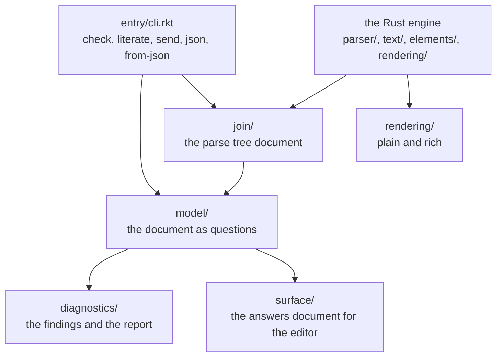

# AIU NOTATION

The text format of the AIU ecosystem. A page is a plain text file with the extension
`.aiu`, and it reads the same way to everyone who reads these files: a person, an AI, a
`grep`, a CLI.

The program has two halves, and both are built and green today:

- the **Rust crate** under `notation/` — the engine: it parses, renders and round-trips a
  page, fast;
- the **Racket package** under `notation/src/` — the model: it reads the engine's
  document, answers questions about a page, and writes the engine's output back out.

## Purpose and boundaries

This package owns the syntax of a page, the parse tree document, the diagnostics, the
rendering, the model that answers questions about a document, and the surface the editor
reads.

What belongs elsewhere:

- the editor owns the buffer and the session;
- the engine boundary that the editor and the notation meet over is frozen in
  `../contract/notation-engine-boundary.org`;
- the workflow engine that will interpret notation is its own project
  (`../AIU-WORKFLOW-ENGINE-FOR-AI`).

The areas, lowest first: `errors`, `narration`, `machine`, `security`, `join`, `text`,
`parser`, `elements`, `model`, `rendering`, `surface`, `data`, `diagnostics`, `literate`,
`generation`, `entry`. A dependency points downward only, and only `join/` may cross
between Rust and Racket.

## The hard rule: the three-line block

A block is three lines, and the keyword comes first both times:

```
title start
tags: sample
The first sample page
title end
```

`end title` is the **retired** spelling. It closes nothing and is ordinary text. The
owner chose this form because the name is the subject of the line and the word after it
says what the line does, so the eye always lands on the same word in the same place.

The names you may use as block names:

`title`, `paragraph`, `code`, `heading`, `table`, `header`, `row`, `comment`.

The declaration keywords, the word before the colon on a line:

`tags`, `language`, `style`, `theme`, `color`, `format`, `font`, `level`, `caption`,
`column`, `cell`, `row-id`, `meta`, `todo`.

A line whose word is **not** in that list stays plain content: a `colour: blue` line is
not a declaration, it is text.

## Current status

| Capability | State |
|---|---|
| The tree, the light gate and the build | Implemented and verified |
| The three-line block form and the first elements | Implemented and verified |
| The round trip: a page prints back to the very same bytes | Implemented and verified |
| Incremental reparse and recovery | Implemented and verified |
| The named elements: outlines, tags, properties, tables, planning states, links | Implemented and verified, except the `link` keyword, which is not registered and the `references` area holds no files |
| Literate code: chunks, targets, scanning, load and send, skip-on-unchanged | Implemented and verified |
| Comments: first-class in the text, stripped by the rendering | Implemented and verified |
| The engine surface for the editor, with stable node addressing | Implemented and verified |
| The rendering tiers: plain and rich unicode | Implemented and verified |
| The seven security rules | Implemented, verification incomplete: the gate probes all seven, and no file calls them yet |
| The kit: the MCP server, the skill, the read-only plugin | Planned (TODO item 10) |
| The notation hosted in the editor, on and off | Planned (TODO item 11) |
| The done-line share | Planned (TODO item 12) |
| One address shape | Open: the model says `title:title@1` and the surface answers say `"title/1"`; one of them has to go |

## Architecture



The engine writes a **parse tree document** and the model reads it. The shape is frozen
in `notation/src/join/INDEX.org`:

```
NOTATION-DOCUMENT 1
file "<path>"
node block <name> <startLine> <startOffset> <endLine> <endOffset> <depth>
decl <keyword> "<value>" <line> <offset>
error <kind> <line> <offset> <openerLine> "<what>" "<whatToDo>"
end
```

A quoted field is one field and keeps its spaces, and a double quote inside is written
twice. The `depth` field says what sits inside what, so a reader never has to count.

## Implemented capabilities

**The engine, four commands and a fifth.**

```bash
notation parse FILE        # the parse tree document; the time goes to stderr as parse-ms: N
notation render FILE       # the plain render: the content, with the marks, the
                           # declaration lines and the comments dropped
notation render-rich FILE  # the same content drawn with unicode: a ═ rule under a
                           # title, a box around a code block, two columns of indent
                           # per nesting level, a ✗ line N mark on an error
notation roundtrip FILE    # says whether the page prints back to the very same bytes
notation todos FILE        # lists every todo in the page
```

**The daily script** does the everyday work in one place, builds the binary if it is
missing, and never writes in the tree:

```bash
nu tools/aiu.nu check     FILE
nu tools/aiu.nu render    FILE
nu tools/aiu.nu roundtrip FILE
nu tools/aiu.nu json      FILE
nu tools/aiu.nu from-json FILE.json
```

**The model, from the shell.** The commands are `check`, `literate`, `send`, `json` and
`from-json`, and the exit codes are named: `exit-clean 0`, `exit-findings 1`,
`exit-refused 2`. The path must be **relative**: the project directory holds a space, and
`racket` splits a path that holds one.

```bash
cd "AIU NOTATION"
racket notation/src/entry/cli.rkt check FILE
```

`check` reads a **parse tree document** — the output of `notation parse` — not a page.
`tools/aiu.nu` does both steps for you.

**What the model answers.** `read-outline` (the document as a tree), `address-of` (a
node's address), `addresses` (every address, in tree order), `property-of` (a
declaration's value on a node), `tags-of` (the tags of a node), `heading-numbers` (the
computed number of every heading), `collect-findings` (the findings of a document),
`build-report` (the report and its exit code), `surface-answers` (the answers document for
the editor) and `read-notices` (the notices document).

**The diagnostics.** A finding is a struct of six fields:

```racket
(struct finding (kind who line column what what-to-do) #:transparent)
```

The kinds are `unknown-element-name`, `tag-names-nothing`, `property-no-value`,
`link-no-target` and `parser-recovery`. A report line reads:

```
ERR err-stray.aiu at line 4, column unknown: parser-recovery: the parser recovered
from stray-text: text outside any named block; what to do: put the text inside a
"<name> start" / "<name> end" block
```

The column says "unknown" because a parse tree document carries no page. The engine's
own error line carries the line, the byte and the line the block was opened at.

**The six errors the engine names:** `stray-text` (text outside any named block),
`mismatched-end` (a close that does not match the open block; it names the block and the
line it was opened at), `unclosed-block` (a block opened and never closed; it names the
line it was opened at), `unknown-block-name` (a name that is not registered),
`missing-title` (a file whose first block is not a title) and `bad-heading-level` (a
`level:` that is not a whole number of 1 or more).

**Headings and their numbers.** A heading takes its depth from a `level:` declaration;
without one it is level 1. The number is computed and never written by you: `1`, `1.1`,
`1.1.1`, `1.2`, `2`. Both halves compute the same numbers — the Rust engine for the
render, the Racket model for the document.

**Tables.** A table holds a `header` block and `row` blocks. A `column:` line names the
column, its type and whether it is optional; the types are `text`, `number`, `integer`,
`bool`, `date` and `json`. An **empty** `cell:` is a **missing** value, and a missing
value is allowed only in an `optional` column. A table is read, checked, and drawn two
ways: as HTML and as LaTeX. The structure is kept apart from the drawing.

**JSON, both ways.** A page becomes a JSON array with one object per top-level block, and
a JSON file read back becomes a `.aiu` page; the two JSON texts come out the same. The
`data` key is the way out for machine-oriented data the notation has no block for. What
JSON cannot hold is said out loud: a comment, a blank line, and the way a heading was
numbered all come back changed or not at all.

**The todo state.** A todo is a line that starts with `todo:`. It may sit on any block —
a title, a paragraph, a heading, a table, a code block — and it may sit inside a comment.
The only place it is not read is the body of a code block, because a code body is not read
as notation.

## Public interface

| Command | What it does |
|---|---|
| `notation parse FILE` | the parse tree document |
| `notation render FILE` | the plain render |
| `notation render-rich FILE` | the unicode render |
| `notation roundtrip FILE` | whether the page prints back byte for byte |
| `notation todos FILE` | every todo, with the line it sits on |
| `racket notation/src/entry/cli.rkt check FILE` | the report and the exit code |
| `racket notation/src/entry/cli.rkt literate\|send\|json\|from-json …` | the rest of the model |
| `nu tools/aiu.nu …` | the everyday script: build, then check, render, roundtrip, json, from-json |

## How it works

1. The engine reads the text and parses it into blocks, declarations and errors.
2. The engine writes the parse tree document, one line per node, with the depth of each
   node.
3. The model reads that document and answers questions about it: the outline, the
   addresses, the properties, the tags, the heading numbers.
4. The findings are collected, and the report is built; the exit code says whether the
   document is clean, has findings, or was refused.
5. The rendering takes the document and draws it: the plain tier drops the marks, the
   declaration lines and the comments; the rich tier draws the rules and the boxes.

The check costs the same on a small page and on a big one, so the cost is the module load
on this phone, not the page. Measured: parse 20 lines 0 ms, parse 2000 lines 40 ms, the
whole check about 18 s on both, `racket -n -e ''` about 0.5 s, loading one module about
11 s, loading the CLI about 23 s.

## Usage

```bash
cd "AIU NOTATION"
cargo build --manifest-path notation/Cargo.toml --target-dir /tmp/notation-target
rm -f notation/Cargo.lock      # the build leaves it behind; the tree stays clean

/tmp/notation-target/debug/notation parse syntax/example.aiu
nu tools/aiu.nu check syntax/example.aiu
racket notation/src/entry/cli.rkt check parse-tree.txt
```

## Configuration and compatibility

- The engine writes nothing inside the project tree; the build target and the temporary
  files live outside it.
- The parse tree document is versioned: `NOTATION-DOCUMENT 1`. A document of another
  version is refused rather than guessed at.
- The model and the engine compute the same heading numbers, and both are proven on the
  same examples.
- The surface the editor reads is the answers document, and its shape is the contract in
  `../contract/notation-engine-boundary.org`.

## Dependencies and integration

- Rust for the engine, Racket for the model, and no other dependency.
- The editor will read the surface; that integration is the engine surface item
  (TODO item 8) and the hosted notation (item 11).
- The kit (the MCP server, the skill, the plugin) will make the notation readable by an
  agent, in the same shape the rest of the ecosystem uses.
- The workflow engine will interpret notation; the notation stays behind its boundary
  (decision D-012).

## Validation, invariants, and error handling

- The round trip is the invariant: a page prints back to the very same bytes.
- The seven security rules are total predicates: a target that names no file, a target
  that is a directory, a target that climbs out with `..`, an absolute target, a target
  that is the document itself, an unwritable place, and a declaration no rule registers
  read out of a code body. The gate probes all seven, on a value that must be refused and
  one that must pass, and names for each rule the files that call it. **Today no file
  calls them yet**, and the gate says so on every run.
- The `comment-lint` stage holds the house style: every file opens with a header comment
  that says what it is, why it exists and who calls it, and every top-level definition has
  a comment line directly above it.
- A refusal names its rule. The exit code carries clean, findings and refused apart, so a
  machine can tell them without parsing prose.

## Testing and verification

The light gate is the only entry point, and it is green at seven stages:

```bash
/root/home/shape/opt/nushell/0.116.1/nu --no-config-file gate/check.nu
```

| Stage | What it checks |
|---|---|
| `paren-check` | every `.rkt` file reads |
| `naming` | no banned word in any name |
| `one-way` | a require may point downward only |
| `security-gate` | every security rule answers as it says |
| `language-split` | only `join/` may cross between Rust and Racket |
| `load-check` | every module loads (42 modules) |
| `comment-lint` | every file has a header and every definition a comment (64 files) |

What is not verified: the kit, the hosted notation, and the two address shapes, which
have to become one.

## Limitations

- The Racket `check` command reads a parse tree document, not a page; the engine makes
  the document and `tools/aiu.nu` does both steps.
- A path that holds a space cannot be handed to `racket`, so every Racket command needs a
  relative path.
- The seven security rules have **no caller**: the literate and the generation areas still
  raise their own refusals.
- The `link` keyword is not registered, and the `references` area holds no files.
- The kit — the MCP server, the skill, the plugin — is not built.
- There are two address shapes: the model says `title:title@1` and the surface answers
  say `"title/1"`. One of them has to go; the hand-off asks for one.
- Nothing is long-lived: every command is a one-shot process.

## Roadmap

`TODO.org` is the one list, in build order. What is left: the kit (the MCP server, the
skill with executed examples, the read-only plugin), the notation hosted in the editor
with the trigger chain running once end to end, the done-line share, and the decision
about the one address shape. The frozen rules of the first slice are in
`syntax/first-slice-freeze.org`, and how to write a page is in `syntax/GUIDE.org`.

## Related documentation

- `TODO.org` — the one list of what is left, in build order.
- `HANDOFF.org` — the true state of the program.
- `EDITOR-HANDOFF.org` — what the editor may use, and how.
- `INDEX.org` — every file in this directory, with its job.
- `plan/package-tree.org` — the register: a name that is not there does not exist yet.
- `syntax/feature-status.org` — one row per feature, with the proof.
- `syntax/first-slice-freeze.org`, `syntax/GUIDE.org`, `syntax/first-run-output.org` — the
  frozen rules, the guide, and a captured run.
- `decisions/` — the choices that were made.
- `rules/` — the hard rules, one file each.
- `questions/usage-inventory.org` — the owner's usage, answered.
- `../contract/notation-engine-boundary.org` — the boundary with the editor.
- `../DECISIONS.org` — the decisions that cross programs.

## Development

```bash
cd "AIU NOTATION"
cargo build --manifest-path notation/Cargo.toml --target-dir /tmp/notation-target
rm -f notation/Cargo.lock
/root/home/shape/opt/nushell/0.116.1/nu --no-config-file gate/check.nu
```

Register a name in `plan/package-tree.org` before you use it. One file, one job, with the
header comment and the comment above every definition. A require may point downward
only. Commit with explicit relative paths, never `git add -A`. Nothing writes outside
`/tmp`. No test files in the tree: the owner lifted that on 2026-10-19 for one
verification run, and those commands live in `/tmp`, never in the tree.
