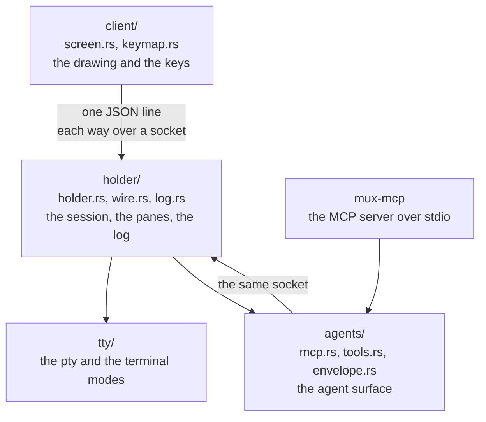

# AIU Terminal Multiplexer

The terminal multiplexer of the AIU ecosystem: shells, panes, tabs, and a session holder
with detach and reattach.

The holder owns the shells and the log. The client is a thin screen: a process that
outlives the program that started it can be attached again, so an OpenCode server, a long
`pm apply` and an editor session all keep running while the human looks at something else.

The terminals are a facade over tty: what the phone cannot promise is written down in
`../WHEN-ON-LAPTOP.org`, never assumed.

## Purpose and boundaries

This package owns the session, the panes inside it, the log of what happened, the screen
that draws it, and the agent surface that reads it.

What belongs here:

- the holder: the session, its panes, its tabs, its log, its socket;
- the client: the screen, the mode line, the keymap, the keymap explorer;
- the agent surface: the MCP server, the tools, the envelope;
- the tty facade: the pty, the terminal modes, the size.

What belongs elsewhere:

- the editor's buffers, tabs and modes stay the editor's;
- the shared workspace belongs to the `../shared-layers/workspace` package;
- the Git model belongs to the `../shared-layers/git-inspection` package;
- pm's packages and install belong to pm.

The area law binds the package: the areas are lowest first (`errors`, `narration`,
`machine`, `security`, `join`, `devloop`, `tty`, `holder`, `panes`, `routing`, `layouts`,
`records`, `client`, `agents`, `control`, `entry`), and a dependency points downward only.
`join/` is the only place Rust and Racket may meet, and the language-split lint keeps it
that way.

## Current status

| Capability | State |
|---|---|
| The holder: a shell on a pty, in a session that outlives its client | Implemented and verified |
| The log: one append-only file per session, flushed per record | Implemented and verified |
| The socket: a unix socket in the session's state directory | Implemented and verified |
| The client: attaches, asks, reads, detaches, holds nothing | Implemented and verified |
| The panes and the layout file | Implemented and verified |
| The drawing: the panes on one terminal, the tab bar, the frame | Implemented and verified |
| The modes: visual, insert, command, explorer | Implemented and verified |
| The selection: the point, the ring of marks, the copy, the send | Implemented and verified: the multiplexer side of the owner's screen-selection plan |
| The tabs and the mode line | Implemented and verified |
| One window size for every pane | Implemented and verified |
| The keymap: one table for the dispatcher and the explorer | Implemented and verified |
| The keymap explorer (Space opens it) | Implemented and verified |
| The agent opens here, with the pane's context attached | Implemented and verified |
| The MCP surface: sessions, records, send | Implemented and verified |
| The key routing between the multiplexer and the editor | In progress: the routes are named, the walk with the editor in a pane is owed |
| The dev mode: work mode, the bake, the last good | Planned (TODO item 7) |
| Select and send to both agents, with the context | Planned (TODO item 8) |
| The Television channels | Implemented and verified: three read-only channels, and television reads all three |
| The workspace engine inside the multiplexer | Planned (TODO item 16) |
| The Git inspection layer inside the multiplexer | Implemented and verified: the key group, the panel and the holder's seam |
| The screen selection (the biomechanical model) | In progress: the multiplexer side landed; the editor's side and the wheel are owed |
| The kit conformance and the done line | Planned (TODO items 11 and 12) |

The owner switched the priority to this program on 2026-10-21: it is the foundation under
the complete workflow, so pm and the editor are paused until it works.

## Architecture



Three binaries in one crate:

| Binary | Job |
|---|---|
| `holder` | owns the session: the panes, the log, the socket, the ops |
| `client` | the screen: attaches, draws, answers the keys |
| `mux-mcp` | the MCP server: the agent's surface over the holder's socket |

The areas, lowest first: `errors/` (the record, the raise, the render), `narration/`
(events, voice, the wait door, the one printer), `machine/` (the HOME seam, the one-writer
locks, the cancellation door), `tty/` (the pty, the terminal modes, the size), `holder/`
(the session and the ops), `client/` (the screen and the keymap), `agents/` (the MCP
server, the tools, the envelope, the context bundle, the redaction seam).

## Implemented capabilities

**The session outlives the client.** The holder writes every record to an append-only
log, flushed per record, so a killed process leaves a readable prefix and not a torn
record (rule 01, and decision D-006). A client that detaches leaves the shells running;
a second client finds the same session and the same shells.

**The ops on the holder's socket.** One JSON object per line, both ways, and the ops are:
`attach`, `detach`, `state`, `read`, `send`, `open`, `resize`, `rename`, `close`. A request
that is not JSON is refused by name, and the refusal says why.

**The panes.** A layout file names the panes of a session; each pane is a shell with a
name, and every record the session writes carries the pane's name, so a send is aimed at a
pane by name. A pane whose program ends goes on its own: the session and the other panes
go on, and the session ends with the last pane.

**The screen.** The multiplexer is modal like the editor. The modes are visual, insert,
command and the keymap explorer. `i` puts the keyboard into the focused pane, the Escape
leaves it without being sent on, and the mode line says where the owner stands: the mode,
the tab, the focused pane and the window size. One window size reaches every pane.

**The keymap is one table** (`multiplexer/src/client/keymap.rs`). The dispatcher reads it
to know what a key means, and the keymap explorer reads the same table to draw it, so the
two cannot drift apart. There is no modifier in it: no Control, no Alt, no Meta, no
prefix chord. A Control key the owner presses belongs to the program in the pane.

| Keys | What they mean |
|---|---|
| `i` | type into the focused pane |
| `Space` or `?` | the keymap explorer |
| `:` | the command line |
| `q` | leave the multiplexer; the session goes on |
| arrows | move the focus between the panes |
| `t` `p` `c` `s` | the tabs, the panes, the commands, the sessions |
| `p o` | open the agent beside the focused pane, with that pane's context |
| `g` | the git: the overview, the changed files, the diff, the history, the branches, the worktrees |

**The keymap explorer.** Space opens it in visual mode. It is a panel over the panes, not
a new screen. It shows the keys of the map it is showing, what each one means, whether it
runs a command or opens a group, and whether it can run now. A group key opens that group,
a command key runs the command, and the Escape cancels at any depth.

**The selection.** The key `v` opens the selection on the focused pane: the mode line says
`SELECT`, and the keys are the keys of the owner's biomechanical input layer. The arrows
move the point, `w b` and `w f` move it by word, `m` pushes a mark onto the ring of marks
and `M` pops it, `y` copies the region into the multiplexer's own ring, `Y` copies the
line the point stands on, `s` sends the region to the agent in the bundle that every
program sends, and `p o` opens the agent beside the pane with the region in that bundle.
The candidates are the visible text of the focused pane only: a line that has scrolled out
of the pane cannot be picked, because it cannot be seen. The escape leaves the selection
and does nothing else — no text is copied, no bundle is sent and no pane opens. The
design, and what is still owed, are in `plan/screen-selection.org`.

**The agent opens here.** One key in the focused pane opens OpenCode beside it, with that
pane's context already attached: the tail of the pane's log, the shell, the place and the
why. The bundle is built by the holder from the holder's own log, so nothing is copied by
hand and the screen never scrapes the drawing. The bundle passes the redaction seam: a
line that names a credential keeps its name and loses its value. The send is a record, and
it is written before the pane opens. The design is in `plan/agent-opens-here.org`.

**The git panel.** The key group `g` opens the git, and the panel shows what the
shared layer read: the repository, the branch and its distance from the upstream, the
worktrees with their counts, the changed files with the marks of the layer, the diff of
the working tree against the index, the history, the branches, and the worktree browser:
every worktree of the repository, one line each, with the branch it stands on, the
changes it holds, and where it lives. The holder asks the
layer and the layer only reads: no command it can run changes a repository, an index, a
branch or a worktree. The panel says which comparison it shows, and an unknown upstream
is never shown as "up to date".

**The agent surface.** The MCP server over stdio talks to a holder's socket, so an AI
agent can list the sessions, read a session's records and send to a session's shell.
Reading is free; a send changes what a session does, so it needs the human's token and the
server checks the token itself. The tools are `multiplexer_sessions`,
`multiplexer_records` and `multiplexer_send`. The server and the skill are registered in
OpenCode on this phone, so a true OpenCode session can drive the multiplexer without the
owner touching the terminal.

## Public interface

The holder's socket, one JSON object per line, both ways:

| Op | What it does |
|---|---|
| `attach` | the client joins the session and starts receiving the records |
| `detach` | the client leaves; the session goes on |
| `state` | the direction, the tabs and the panes, as data |
| `read` | the records after a sequence number, from the log |
| `send` | text to a named pane's shell |
| `open` | a new pane, with a program, arguments and a tab |
| `resize` | the window size for every pane |
| `rename` | a pane or a tab gets a new name |
| `close` | a pane or a tab goes away |

The client's own options:

```bash
client --state-dir DIR --op screen [--agent-program PATH] [--editor-program PATH]
client --state-dir DIR --op state|read|send|open|resize|rename|close ...
```

The layout file, one JSON object, naming the panes:

```json
{
  "direction": "row",
  "panes": [
    { "name": "work", "tab": "main", "program": "/bin/sh", "weight": 2, "cols": 80, "rows": 24 }
  ]
}
```

The MCP tools, over stdio, one JSON-RPC request per line: `multiplexer_sessions`,
`multiplexer_records`, `multiplexer_send`. The last one needs the human's token.

## How it works

1. The holder starts, reads the layout, starts one shell per pane on a pty, and opens its
   socket in the state directory.
2. Every pane's output is read, turned into a record and written to the log, flushed per
   record; the record carries the pane's name, the kind, the what and the why.
3. A client connects, asks for the state, and attaches. From then on it receives the
   records and redraws.
4. A key in visual mode is read against the keymap table. The result is either a command,
   a group, or a sequence still being typed.
5. A command that needs the holder becomes a request on the socket; the answer comes back
   as a record and the screen redraws.
6. A client that is leaving detaches and waits for the holder's answer, so a request it
   asked for is never lost to a connection that closed too early.

No timer anywhere: every wait ends on an event — a record, a socket answer, a key.

## Usage

```bash
cd "AIU TERMINAL MULTIPLEXER/multiplexer"
CARGO_TARGET_DIR=/tmp/opencode/mux-target cargo build --offline

# the holder owns the session
/tmp/opencode/mux-target/debug/holder --state-dir /tmp/mux-demo --shell /bin/sh

# the client draws it
/tmp/opencode/mux-target/debug/client --state-dir /tmp/mux-demo --op screen
```

A session with a layout file of its own:

```bash
/tmp/opencode/mux-target/debug/holder --state-dir /tmp/mux-demo --layout layout.json
```

The agent surface, for an MCP client:

```bash
/tmp/opencode/mux-target/debug/mux-mcp --sessions-dir /tmp
```

## Configuration and compatibility

The holder takes its options on the command line: `--state-dir`, `--shell`, `--layout`,
`--cols`, `--rows`. It has no config file, and rule 03 says so: the holder has no config
and no timers.

The state directory holds the log, the socket and whatever else the session writes. The
log is one file per session, and the format is frozen in `../contract/event-log-format.org`
and `../contract/structured-records.org`.

The client and the holder are versioned together by the two contract constants they
report: the event contract and the holder contract. A client refuses a holder that speaks
a different contract rather than guessing.

## Dependencies and integration

- `libc` and `serde_json`, and nothing else: the phone's cargo registry cache holds no
  other crate, so no other dependency may be added.
- The tty is the Linux pty (`/dev/pts/N`), measured working on this phone.
- The shared `../shared-layers/git-inspection` package is used: the holder asks the
  layer and the panel shows the answer. The shared `../shared-layers/workspace` package
  is not read yet (TODO item 16).
- The editor is the other half of the key routing, and the multiplexer holds the reserved
  prefix (decision D-005).
- Television is the picker for the channels. The `tv` binary is on this phone now
  (television 0.15.9, built from the source): it reads the cable directory, and the
  three channels in `picker/` are in it — the records of a session, the panes of a
  session, and the live sessions themselves. The channels are read-only — the picker browses
  data, it never executes — and `tools/install-tv-channels.nu` only prints the commands
  that install them.

## Validation, invariants, and error handling

- Every request is one JSON object; a line that is not one is refused by name, and the
  refusal says what would be accepted.
- A refusal names its rule. A client that asks something the holder does not do gets a
  record that says so, not silence.
- Nothing that changes the repository, the index, a branch or a worktree is in the command
  set at all. The multiplexer has no mutating Git command; the shared Git layer is
  read-only by construction.
- The keymap has no modifier binding, and the gate's one-way lint and language-split lint
  hold the area law and the Rust/Racket boundary.
- A pane whose program ends does not take the session with it; the session ends with the
  last pane.

## Testing and verification

The light gate is the only entry point, and it is green at seven stages:

```bash
/root/home/shape/opt/nushell/0.116.1/nu --no-config-file gate/check.nu
/root/home/shape/opt/nushell/0.116.1/nu --no-config-file gate/check.nu --list
```

| Stage | What it checks |
|---|---|
| `paren-check` | every Racket file reads |
| `text-lint` | the text rules: line length, trailing space, tabs |
| `naming-register` | every file is listed in `multiplexer/INDEX.org` |
| `banned-words` | no banned word in any name |
| `one-way` | a dependency may point downward only |
| `security-gate` | the security rules answer as they say (nothing to check yet) |
| `language-split` | only `join/` may cross between Rust and Racket |

The Rust tests: `cargo test --offline` (22 tests at the time of writing).

The phone proofs, each a Nu script that prints its evidence:

| Probe | What it proves | Checks |
|---|---|---|
| `tools/holder-probe/probe.nu` | the shell survives the client's detach | 7 |
| `tools/panes-probe/probe.nu` | the panes and the layout file | 6 |
| `tools/mcp-probe/probe.nu` | the agent's surface, and the token refusal | 6 |
| `tools/screen-probe/probe.nu` | the drawing, the modes, the keymap, the agent key | 22 |
| `tools/tiny-binary-probe/` | the build and start times that decided the route | measured |

What is not verified: the key routing with the editor in a pane, the dev mode, the
Television channels, and the kit conformance.

## Limitations

- The `join/` seam carries nothing yet: no Rust and Racket cross in this package, and the
  language-split lint keeps it that way.
- There is no configuration file, by rule 03; the layout file is the session's shape.
- The screen draws plain text with escape codes: no true colour, no mouse, no sixel.
- The Television picker is on the phone and reads the cable, so the channels can be
  written and
  checked at source level here.
- The multiplexer is Rust only; the meaning side of the editor is Racket, and the two meet
  in the editor's own `join/`.

## Roadmap

`TODO.org` is the one list, in build order. The next items are the key routing across
layers with the editor in a pane, the dev mode, select and send to both agents, the
Television channels, the kit conformance, the done line, and the workspace engine joining
the multiplexer so that the mode line names the workspace and the project. The screen
selection (the biomechanical model: the overlay, the visible text only, the second key as
the action) is designed in `plan/screen-selection.org` and not built.

## Related documentation

- `TODO.org` — the one list of what is left, in build order.
- `HANDOFF.org` — what a fresh conversation needs to start here.
- `INDEX.org` — every file in this directory, with its job.
- `plan/package-tree.org` — the register: a name that is not there does not exist yet.
- `plan/architecture.org`, `plan/holder-design.org`, `plan/panes-design.org` — the design.
- `plan/agent-opens-here.org`, `plan/keymap-explorer.org`, `plan/modes-tabs-and-the-window.org`,
  `plan/screen-selection.org` — the designs that landed, and the one that did not.
- `plan/build-order.org`, `plan/risks.org`, `plan/phone-first-tests.org` — the order and
  the risks.
- `rules/` — the hard rules, one file each.
- `research/` — what was measured on this phone.
- `../contract/` — the one written contract between the programs.
- `../DECISIONS.org` — the decisions that cross programs.

## Development

```bash
cd "AIU TERMINAL MULTIPLEXER/multiplexer"
CARGO_TARGET_DIR=/tmp/opencode/mux-target cargo build --offline
CARGO_TARGET_DIR=/tmp/opencode/mux-target cargo test --offline
cd ..
/root/home/shape/opt/nushell/0.116.1/nu --no-config-file gate/check.nu
```

Nothing is written inside the tree: the build writes its target directory outside, and
the state directory is an argument. Register a name in `plan/package-tree.org` and in
`multiplexer/INDEX.org` before you use it; one file, one job; a dependency points
downward only; commit with explicit relative paths; never `git add -A`; a commit leaves
the gate green.
