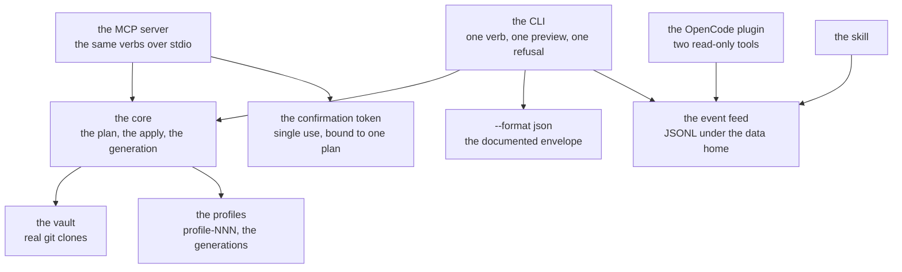

# pm — the generational package manager for the AIU ecosystem

pm installs and records what a machine has. It is declarative: you declare what you
want, pm plans it, applies it, and keeps every change in a generation you can roll back.

> **read is free · changing disk needs you (`--confirm`) · refusing is loud**

pm treats disk mutation as irreversible entropy and therefore refuses to perform it without
an explicit human `--confirm`. Read paths are free. Activation is atomic and fail-closed.
The vault is real Git clones. Profiles are immutable generations. Rollback is a pointer
move. Everything important is narrated. Agents receive the same verbs and the same
refusals.

**Last updated:** 2026-10-22
**Status:** the core surface is complete and gated; the implementation is **paused** by
the owner (2026-10-22), because the terminal multiplexer is built first.

**Working now:** the everyday commands except `pm backup`, the why/owner surface, the
profiles and generations, and the machine surface.
**Still to land:** `pm backup`, the planned amplifications below, then acceptance.

## Why pm is paused: the multiplexer comes first

The complete workflow needs a process that outlives the program that started it: an
OpenCode server, a `pm apply` that takes minutes, and an editor session all have to keep
running while the human looks at something else, and all three have to be attachable
again afterwards. The multiplexer is that: persistent sessions, a process lifecycle, and
attach/detach. pm and the editor sit **on** it.

How pm plugs in:

- every long pm command runs in its own multiplexer session, so a slow `pm apply` keeps
  running after the terminal that started it is gone;
- pm's narration (the event feed) is the session's output stream, so the feed is read in
  the same place as the editor's own output;
- a pm run that must be watched is attached, not restarted.

**What is paused:** every item in `TODO.org` that is not documentation. Nothing in this
tree is being rewritten, redesigned, or thrown away.

**Resume conditions — all three, then work continues:**

1. the multiplexer builds, its own gate is green, and persistent sessions plus
   attach/detach are proved on the phone;
2. `TODO.org` names the multiplexer work as done and lists what pm still owes;
3. this README says what the integration is, with the paths.

**Verified at the pause:** the full gate green on `28384b5f` — 111 test files, 1586
checks, 0 failed; `one-way-dependency-lint` 0 new violations; `wait-door-lint` 0
violations.

## Purpose and boundaries

pm owns the declaration of what should be installed, the plan of what an install would do,
the act of doing it, the generations of what was done, and the record of every run.

What belongs elsewhere:

- the long-running processes belong to the terminal multiplexer;
- the editor asks pm for plugins; pm owns the packages, the editor owns the conversation;
- the workspace model belongs to the `../../shared-layers/workspace` package, and the Git model to
  `../../shared-layers/git-inspection` — pm's vault is Git clones, but it is pm's own vault, not the
  shared read-only layer.

## Current status

| Capability | State |
|---|---|
| `check`, `plan`, `apply`, `lock`, `fetch`, `update`, `verify`, `status` | Implemented and verified |
| The vault as real Git clones, with per-entry status | Implemented and verified |
| Dev mode: a package may point at a live working copy | Implemented and verified |
| The profiles, the immutable generations, the rollback as a pointer move | Implemented and verified |
| The why/owner surface: `why`, `owner`, `outdated` | Implemented and verified |
| The machine surface: `--format json`, the recorded run, the JSONL feed | Implemented and verified |
| The MCP server: the same verbs, the confirmation token | Implemented and verified |
| The OpenCode plugin and the skill | Implemented and verified |
| The Television channels | Implemented and verified (`agent/tv/`) |
| `pm backup` | Planned |
| The eleven planned amplifications below | Planned |
| The content-addressed overlay, the signed revisions, the parallel fetch | Planned, later |
| Install hooks, services, a vulnerability audit | Deliberately not planned |

## Architecture



The source model has four parts:

1. **It clones.** `fetch` materializes real Git clones into the vault. Each entry carries a
   revision, and that revision is what `lock` pins, `verify` re-checks, and `update`
   compares against the vault.
2. **Git-tracked, your own repos included.** Clones are ordinary checkouts; the revision is
   the pin. Vault origins admit `https://`, `ssh://` and scp-like shapes; `file://` is an
   explicit test-only escape (`current-allow-file-urls` in `git-env.rkt`, never
   environmental).
3. **Dev mode.** A package may point at a live working copy instead of a fetched clone:
   change the sources, load the build, no fetch round-trip.
4. **Backed up** (planned): the declaration and the source snapshot land in your Git repo
   as `decl/<name>.spec` and `vendor/<name>/`, pushed on every run.

## The commands

| Command | Purpose |
|---------|---------|
| `pm check DIR` | One clean line per good spec; every error shown. Exit 3 if bad. |
| `pm plan SPECS` | Show exactly what an install would do. Changes nothing. |
| `pm apply SPECS [--lock LOCK] [--confirm]` | Preview without `--confirm`; it names the flag. |
| `pm lock LOCKFILE` | Pin the world to exact versions. |
| `pm fetch MANIFEST` | Pull every declared package into the vault (real clones; per-entry status). |
| `pm backup SPECS [--confirm]` (planned) | Back up declarations and sources to your Git repo. |
| `pm update VAULT LOCKFILE PROFILE` | Check every locked package; report what is behind. |
| `pm verify VAULT LOCKFILE NAME` | Check a pinned artifact is really what it claims. |
| `pm status PROFILE LOCKFILE` | Installed versus declared at a glance. |
| `pm --help` | Every command with its operands (`-h` is the same). |

`pm backup` (planned): you name a Git repo; after `fetch` the declaration and the source
snapshot are committed there and pushed. A failed push never fails the fetch; it retries on
the next run. Secret-named files are never copied, and an oversized source copies its
declaration only.

### Profiles and generations

| Command | Purpose |
|---------|---------|
| `pm activate PROFILE SPECS STATE [--lock LOCK]` | Validate; build `profile-NNN/`; flip. |
| `pm rollback PROFILE N` | Point the profile at generation N; the old generations stay on disk. |
| `pm remove PROFILE NAME SPECS STATE` | Build the next generation minus a package (gc frees disk). |
| `pm hold` / `pm held` | Pin a package and a slot against updates and gc; `held` lists them. |

The release side (`profile-unhold`) and the GC (`profile-gc`: keeps the newest N, the live
ones and the held ones, and reports what was kept and what was deleted) live on the
library surface, not behind a CLI verb yet.

### Answering "why?"

| Command | Purpose |
|---------|---------|
| `pm why LOCKFILE MANIFEST NAME` | Why is this package here, and who brought it in. |
| `pm owner PROFILE REL` | Which package owns a given path (e.g. `bin/prog`). |
| `pm outdated VAULT LOCKFILE PROFILE` | What is behind, straight from the vault. |

## The machine surface

- Every command accepts `--format json`, with a documented envelope that is golden-tested
  against the org docs.
- Every invocation is a recorded **run**: the full START / STEP / END / WAIT / FAIL
  narration. Nothing important is silent.
- The narration lands on disk as JSON Lines under `$XDG_DATA_HOME/aiu-pm/events/` —
  `<run-id>.jsonl` plus a `current` pointer; the MCP feed tools and the OpenCode plugin
  read that same feed.
- The exit codes are named: 0 ok · 3 spec invalid · 4 resolve · 5 fetch · 6 verify · 7
  build · 8 install · 9 activation conflict · 70 internal · 78 config · 130 cancelled.
- The MCP server exposes the same verbs to agents over stdio JSON-RPC: the sixteen command
  tools (`help` excepted) plus three read-only feed tools — `events.runs`, `events.tail`,
  `run.get`. The read tools run free; every tool flagged as mutating refuses with
  `-32001` unless the call carries the confirmation token `initialize` handed out.
- The OpenCode plugin (`agent/opencode-plugin/`) has two read-only tools,
  `aiu_run_status` and `aiu_events_tail`, over the same feed; it registers no
  state-changing tool. Run `npm install` in that directory once — it declares the single
  dependency the plugin imports, `@opencode-ai/plugin` — then `node test.mjs` checks it
  offline.
- The skill (`agent/skills/aiu-pm/SKILL.md`) tells an AI when to use each command and how
  to read the feed.
- Unwired commands refuse loudly.

## How it works

1. A spec (or a directory of specs) is **checked**: every error is shown, and a bad spec
   exits 3.
2. `plan` resolves the world and shows exactly what an install would do, changing
   nothing.
3. `apply` without `--confirm` previews and names the flag that would do it. With
   `--confirm`, it fetches, builds, and flips the profile to a new generation.
4. The activation is atomic and fail-closed: either the new generation is complete and
   the profile points at it, or nothing moved.
5. Every step is narrated, and the narration is the record the agents and the plugin read.
6. `pm rollback PROFILE N` points the profile at an older generation; the generations
   stay on disk, and the gc frees the disk later.

## Usage

```bash
pm check DIR                       # is every spec good?
pm plan SPECS                      # what would an install do?
pm apply SPECS --lock pm.lock     # preview: it names the flag
pm apply SPECS --lock pm.lock --confirm
pm status ~/.local/share/aiu-pm/profiles/main pm.lock
pm --format json why pm.lock manifest.json some-package
```

## Configuration and compatibility

- The event feed lives under `$XDG_DATA_HOME/aiu-pm/events/`; the state root holds the
  profiles and the generations.
- The vault origins admit `https://`, `ssh://` and scp-like shapes; `file://` is a
  test-only escape that is never taken from the environment.
- The JSON envelope is documented in `docs/API.org` and golden-tested, so the shape does
  not drift.
- The MCP surface is the CLI surface with the same verbs and the same refusals, and it
  is still gated.

## Dependencies and integration

- Racket, and the standard library. The `file://` escape and the Git work are pm's own.
- The multiplexer, for the long runs: every long pm command will run in its own session.
- The editor, as a consumer: the editor asks pm for plugins and never installs by itself.
- The OpenCode plugin and the skill are pm's own agent surfaces.

## Validation, invariants, and error handling

- **Read free, mutation gated, refusal loud.** A mutating command without the
  confirmation is refused, and the refusal names the flag or the token it wants.
- **Activation is atomic and fail-closed.** A conflict exits 9 and nothing moves.
- **The four token refusals each have their own name**: `needs a confirmation token`,
  `wrong confirmation token`, `confirmation token already used`, `confirmation token is
  for a different plan`. A caller that cannot tell them apart cannot act on any of them.
- **The token is single-use and never clock-bound**: 32 bytes from the OS random source,
  spent by the first state-changing call it approves, and dead when its session ends.
  There is no TTL, because a wall-clock expiry is a second thing that can fail silently.
- **Every token request is narrated as a WAIT event**, so "an agent is asking for mutation
  rights" is in the feed before the answer can arrive.
- **The CLI/MCP asymmetry is deliberate**: a human at a terminal *is* the confirmation, so
  the CLI acts directly; an agent is not a human, so MCP requires the token. Both read one
  shared list of state-changing commands, and neither keeps a second copy of it.
- **Unwired commands refuse loudly** rather than pretending to work.

## Testing and verification

The full gate is the entry point, and it runs the whole test suite and every lint:

```bash
nu gate/check.nu
nu gate/check.nu --list
```

At the pause it was green on `28384b5f`: 111 test files, 1586 checks, 0 failed, with the
one-way dependency lint and the wait-door lint at zero violations. The suite lives in
`package-manager/tests/`, and the test doubles live apart from the production code.

## Limitations

- pm does not run on this phone: its Racket package database cannot be read by the
  phone's Racket, so the editor's plugin install says so and installs nothing. That break
  is pm's to fix.
- The `tv` picker is not on the phone; the channels are written and checked at source
  level here.
- Long builds and long test runs belong on the laptop.

## Roadmap

The planned amplifications, in the order they were specified. Each moves from "Planned" to
"Current" here the moment it lands.

1. **The event feed as a first-class query surface.** `pm events list [--since] [--until]
   [--status]`, `pm events replay RUN-ID`, and the MCP `run.diff` that compares two run
   narrations and surfaces only the divergent STEPs. The plugin and the skill consume the
   structured feed instead of any ad-hoc parsing.
2. **The hold and the GC surface, bound to the activation conflict.** `pm unhold` and
   `pm gc` become real verbs with the same `--confirm` discipline; when `pm activate` would
   fail closed, pm offers to hold the conflicting packages at their previous generations,
   and a STEP in the feed says the hold was applied. `pm status` reports the held packages
   explicitly.
3. **A tighter agent contract around the confirmation token.** Single-use and never
   clock-bound (landed); bound to one plan (landed); the four named refusals (landed); the
   WAIT event for every token request (landed).
4. **Secondary moves the feed now makes cheap.** `pm generation show N` reconstructs what
   was activated by replaying the original run's STEPs; desired-state documents are stored
   as ordinary events and the planner diffs the current generation against them; the
   content-addressed overlay attaches content hashes to artifacts from the feed alone.
5. **`pm doctor`**: one read-only health check — broken profile symlinks, orphaned store
   directories, stale locks, and vault clones that disagree with the lock. It repairs
   nothing, so it has no `--confirm`, and it exits non-zero with every finding named.
6. **`pm export` / `pm import`**: portable bundles. `pm export PROFILE [--confirm]` turns a
   profile into declarations, a lock and optional sources; `pm import BUNDLE [--confirm]`
   rebuilds that profile on another machine, and the import previews without `--confirm`.
7. **The binary cache: build once, reuse by content hash.** `verify` re-hashes a cached
   artifact before trusting it; a cache is never a source of truth; a hash miss is an
   ordinary rebuild, narrated as such.
8. **`pm search` / `pm info NAME`**: browse the declared packages by name and summary, and
   read one package's version, source, dependencies, owner and holds. Both read-only.
9. **`pm shell SPECS`**: a temporary environment with the packages on `PATH`. No new
   generation and nothing persisted.
10. **Users and declarations.** One declaration per user (`user.rktd`); one shared store
    with per-user histories; `pm user list` / `show` / `apply`, `pm add` / `drop`; a
    cross-user apply needs `--confirm` **and** the token, while applying to yourself needs
    `--confirm` only; the system layer's name is reserved so nothing else takes it; and the
    gc frees a shared store path only after every user's live and held generations have
    been counted.
11. **Config and completions.** `pm config` is a read-only view of the effective settings
    and the layer each came from; the completions are generated from the command table
    (Nushell first, then bash, zsh and fish); a check regenerates them and fails when a
    committed file differs; and pm never installs them — it prints or copies them.

Later, from the earlier nine: the content-addressed overlay; signed revisions and
provenance; parallel fetch with isolation; `pm diff PROFILE N M`; profile stacking and
overlays; a reproducible build sandbox; network-off builds with a fixed UID and a fixed
filesystem view; and the lockfile update as a pure proposal, so agents propose and only
the human accepts.

## Deliberately not planned

- **Install hooks.** Arbitrary code run at install time would break fail-closed: a hook
  could change the machine after the plan was approved. pm will not grow a place to run
  unapproved code.
- **Services.** Running and supervising daemons is a different job with a different
  failure model.
- **A vulnerability audit.** It needs an advisory source pm does not have; until one is
  chosen, pm will not claim a package is safe.

## The invariants that will never move

- Read free, mutation gated, refusal loud.
- Activation atomic and fail-closed.
- The vault is real Git clones, with first-class local origins and dev-mode live working
  copies.
- Full narration of every run.
- The MCP surface is identical to the CLI surface, and still gated.
- Nothing exists only locally: declarations and sources can always be backed up off the
  machine.
- One store, many users; no user can change another's profile.

## Related documentation

- `TODO.org` — the one list of what is left, in build order.
- `HANDOFF.org` — what a fresh conversation needs to start here.
- `plan/DECISIONS.org` — pm's own decision log, newest first.
- `plan/FILE-INVENTORY.org` — every file, one line each: the model of the naming law.
- `plan/NAMING-REGISTER.org` — the old path, the new path, the one job.
- `docs/API.org` — the JSON envelope, with the goldens.
- `gate/` — the gate: the dispatcher and its named stages.
- `package-manager/src/*/README.org` — the per-area register, one file each.
- `agent/` — the MCP server, the OpenCode plugin, the skill, the Television channels.
- `../../README.md` — the ecosystem this package belongs to.
- `../../HARD-RULES.org` — the rules that bind every project, including this one.

## Development

```bash
nu gate/check.nu
nu gate/check.nu --list
racket tools/repl.rkt
```

`racket tools/repl.rkt` starts a persistent Racket REPL with pm's core modules loaded
once. A fresh Racket process measures 0.29–1.12 s on this phone for the same empty
program, so the REPL pays that once and stays resident: every expression after the first
costs microseconds. A module that fails to load names itself and is skipped, so one
broken file never takes the session down. One expression per line; blank and `;` lines
are ignored; EOF ends it.

The conventions are the ecosystem's: one file, one job, a name that says what the thing
does, a commit with explicit relative paths, never `git add -A`, and a commit that leaves
the gate green.
