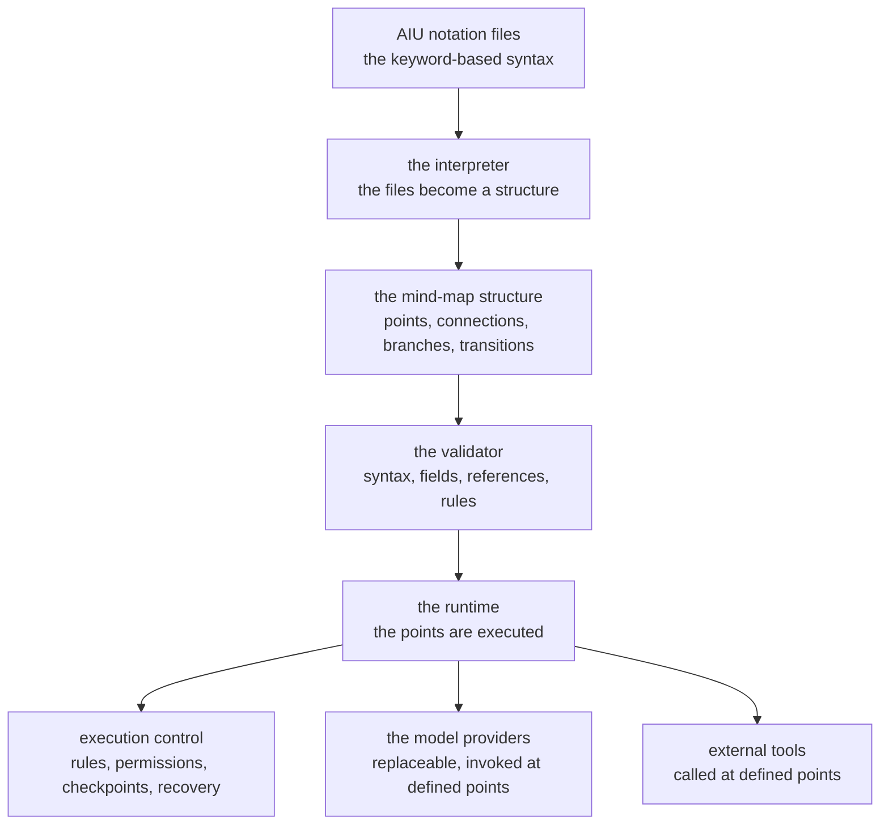

# AIU Workflow Engine for AI

An engine that interprets AIU notation to define, control, execute, validate and monitor AI
workflows through a mind-map-based structure.

The AIU files define the workflow. The engine enforces it. The AI model operates within
its permitted boundaries.

**Nothing is built yet.** This is the concept, the architecture and the minimal
implementation plan.

## Purpose and boundaries

The package answers one question: how does a workflow become a thing an engine can run,
and an AI model can work inside, without either of them inventing their own rules?

Five pieces, kept apart on purpose:

- **AIU notation** — the custom keyword-based syntax and file format. It belongs to the
  `../AIU NOTATION` package; this engine reads it.
- **Mind-map-based workflows** — the structure that defines the workflow points, the
  connections, the branches and the transitions.
- **The workflow engine** — the interpreter and the runtime that enforce the rules and
  execute each point.
- **AI models** — replaceable intelligence providers, invoked where the workflow requires
  them.
- **Execution control** — the rules, the checklists, the standards, the permissions, the
  failure handling, the checkpoints and the verification.

What belongs elsewhere:

- the notation's own syntax, its parser and its model belong to `../AIU NOTATION`;
- the agent adapters, the MCP servers and the skills belong to the programs that own
  them;
- the Git layer that would be used by the workflow's own actions is
  `../shared-layers/git-inspection`, and it is read-only: a workflow that changes a repository would
  need the future permission-checked layer, not that one.

## Current status

| Capability | State |
|---|---|
| The concept, the architecture principle and the minimal implementation plan | Implemented: written down here |
| The notation's keywords, grammar and file format | Planned: step 1 of the plan, and it belongs to the notation package |
| The mind-map structure for points, connections, branches, conditions and transitions | Planned: step 2 |
| The interpreter that parses AIU files into a structured representation | Planned: step 3 |
| The validator for syntax, required fields, references, rules and transitions | Planned: step 4 |
| The workflow runtime that executes points and enforces permissions and standards | Planned: step 5 |
| The replaceable AI model providers and the external tools at defined points | Planned: step 6 |
| The execution state, the logging, the checkpoints, the retries and the recovery | Planned: step 7 |
| The tests, starting with simple workflows | Planned: step 8 |

## Architecture

The architectural principle is that the notation, the mind-map structure, the execution
engine and the model providers stay **separate**. The workflow format and the runtime can
then evolve without tying the project to a single AI model or to a single orchestration
framework.

The runtime is where the permissions live: a model provider may only act inside the
permissions the workflow gave it, and every action is recorded the way the rest of the
ecosystem records what it does.

## Reference software

The design is informed by, and does not depend on, four existing systems:

- **LangGraph** — a graph of steps with a state that moves through them.
- **Temporal** — durable execution, and a workflow that survives a restart.
- **Prefect** — a task graph with retries and observability.
- **Kestra** — declarative orchestration with a UI over a data model.

Each of them is a source of ideas, not a dependency: the ecosystem's rule is that a
component brings no dependency it cannot hold on the phone.

## The minimal implementation plan

1. Define the AIU notation, the keywords, the grammar and the file format.
2. Define how the mind-map structure represents points, connections, branches,
   conditions and transitions.
3. Build an interpreter that parses AIU files into a structured representation.
4. Build a validator that checks the syntax, the required fields, the references, the
   rules and the transitions.
5. Build a workflow runtime that executes the points and enforces the permissions and
   the standards.
6. Integrate the replaceable AI models and the external tools at explicitly defined
   workflow points.
7. Add the execution state, the logging, the checkpoints, the retries, the failure
   handling and the recovery.
8. Test the engine with simple workflows before expanding its capabilities.

The order matters: the format and the structure come first, because a runtime that
executes a format nobody has agreed on is a runtime nobody can change.

## Public interface

None yet: there is no code. What the package will offer is a file format, a structure for
the workflows, an interpreter and a validator that can be run over a file, and a runtime
that can be pointed at a workflow and driven step by step.

## How it works

The intended flow, once it is built:

1. The interpreter reads the AIU files and produces the structured representation: the
   points, the connections, the branches, the conditions and the transitions.
2. The validator checks the structure and refuses, by name, what does not hold: a missing
   field, a reference that points at nothing, a transition that has no rule behind it.
3. The runtime takes a point and executes it, under the permissions the workflow gave
   that point, and records what it did.
4. A point that needs a model calls a provider; a point that needs a tool calls the tool.
   Both are named in the workflow, and both are inside the boundary the workflow set.
5. The state, the log and the checkpoints carry the run, so a failure can be retried or
   recovered, and the run can be audited afterwards.

## Dependencies and integration

- AIU notation, from `../AIU NOTATION`, behind its engine boundary
  (`../contract/notation-engine-boundary.org`).
- The model providers are replaceable, so no provider is a dependency of the engine.
- The event discipline of the ecosystem — the same record shape as the multiplexer, the
  editor and pm — is what the run's log will use.
- The ecosystem's permission rule is the model: read is free, a mutation needs a human,
  and the engine re-checks the confirmation itself.

## Validation, invariants, and error handling

- The validator runs before the runtime, and a workflow that does not validate never
  runs.
- A refusal names the rule, the point and what would be accepted instead.
- The permissions of a point are the boundary for the model and the tool inside it.
- The run is journalled: the state, the log and the checkpoints are what a retry or a
  recovery reads.

## Testing and verification

Nothing is verified here yet, because nothing is built. The plan is to test the engine
with simple workflows first, and to grow the tests with the runtime.

## Limitations

- There is no implementation, so the mind-map structure is still a description: how a
  branch, a condition and a transition are written in a file is not settled.
- The model providers' interface is not written down yet, only the principle that they
  are replaceable.
- The permission model of a workflow point has to be reconciled with the ecosystem's
  existing boundary rules, and that reconciliation is still open.

## Roadmap

The eight steps above are the roadmap, and the notation package's own item 11 (the
notation hosted on and off) and the ecosystem's shared checklist are the neighbours of
this work. There is no `TODO.org` here yet: the package is one document, and it becomes a
plan when the first step starts.

## Related documentation

- `../AIU NOTATION/README.md` — the notation the engine reads.
- `../README.md` — the ecosystem this package belongs to.
- `../contract/notation-engine-boundary.org` — the boundary between the notation and
  whatever consumes it.
- `../contract/ai-link-boundary.org` — the agent boundary the model providers will sit
  behind.
- `../DECISIONS.org` — the decisions that cross programs.
- `../HARD-RULES.org` — the rules that bind every project, including this one.

## Development

There is no build yet. When the work starts, the conventions are the ecosystem's: the
notation, the mind-map structure, the execution engine and the model providers stay
separate; one file, one job; a name that says what the thing does; a commit with explicit
relative paths; and a commit that leaves the gate green.
