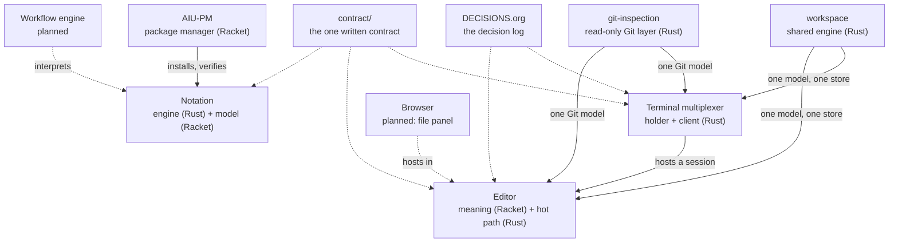

# AIU Ecosystem

AIU (Atomic Information Unit) is a minimal, self-contained unit of information: it has an
identity, a structure, and enough context to stand alone and link into a larger system.

This repository holds the ecosystem: several standalone programs that share one design law
and one written contract, plus the shared packages they both read.

- **Nothing important is silent.** Every operation narrates what, why, how and when.
- **Nothing important is irreversible without a record.** Work is journalled; a step can be
  skipped with a reason and resumed.
- **AI is a first-class operator, not a bolt-on.** Every program ships an engine, an MCP
  server, a skill and a plugin, with one JSON shape across all four.
- **Read is free; changing state needs a human.** A refusal names the rule that refused.

Each program works alone. None of them needs another to be useful; the contracts between
them are written down and the bridges are explicit.

## What lives here

| Package | What it owns | README |
|---|---|---|
| AIU-PM | The package manager: install, plan, rollback | [AIU-PM](AIU-OS/AIU-PM/README.md) |
| Terminal multiplexer | Shells, panes, tabs, the session holder | [mux](<AIU TERMINAL MULTIPLEXER/README.md>) |
| Editor | Buffers, modes, routes, the send to an agent | [editor](<AIU EDITOR/README.md>) |
| Notation | The text format: the engine, the model | [notation](<AIU NOTATION/README.md>) |
| Browser | The file panel for the editor | [browser](<AIU BROWSER/README.md>) |
| Workflow engine | The planned engine over notation | [engine](AIU-WORKFLOW-ENGINE-FOR-AI/README.md) |
| shared-layers/workspace | The shared workspace model and store | [workspace](shared-layers/workspace/README.md) |
| shared-layers/git-inspection | The shared read-only Git model | [git](shared-layers/git-inspection/README.md) |

`contract/` holds the one written contract between the programs. `DECISIONS.org` is the
ecosystem decision log, append-only, newest first. `HARD-RULES.org` holds the rules that
bind every project, each written so a gate can check it.

## Current status

The ecosystem is not one finished system. It is four programs at different stages, and the
table says which stage each is in.

| Package | State | Evidence |
|---|---|---|
| AIU-PM | Implemented and verified, **paused** | full gate green, 1586 checks |
| Terminal multiplexer | In progress | light gate green, 7 stages |
| Editor | In progress | light gate green, 14 stages |
| Notation | In progress | light gate green, 7 stages |
| shared-layers/workspace | Implemented and verified | 20 cargo tests |
| shared-layers/git-inspection | Implemented and verified | 51 cargo tests |
| AIU BROWSER | Planned | the plan, the rules, the studies |
| Workflow engine | Planned | the concept and the plan |

What "in progress" means, per package:

- **Terminal multiplexer** — the holder, the client, the panes, the screen, the keymap,
  the keymap explorer, the agent surface and the agent-opens-here key work. The key
  routing with the editor, the dev mode, the Television channels, the kit and the done
  line do not.
- **Editor** — the tree, the journal, the routes, the live session, the dev mode, the
  send, the region, the audit, the secrets seam, the kit, the plugin system and the tasks
  work. The agent opening beside the editor, the editor's keymap explorer and the
  workspace engine do not.
- **Notation** — the Rust engine and the Racket model are both built and green. The kit,
  the hosted notation and the one address shape do not.

The evidence in full:

- AIU-PM: the full gate green on `28384b5f` — 111 test files, 1586 checks, 0 failed.
- Terminal multiplexer: 22 cargo tests and four phone probes green (holder 7, panes 6,
  MCP 6, screen 22).
- Editor: the light gate green at 14 stages, 0 of them checking nothing.
- Notation: the light gate green at 7 stages, 42 modules loaded, 64 files checked.
- workspace: 20 cargo tests and a phone end-to-end run.
- git-inspection: 51 cargo tests, including real temporary repositories and the safety
  proof that the inspection changes nothing.

The one rule that cuts across all of it: **the multiplexer is the foundation**. The owner
switched the priority on 2026-10-21, so pm and the editor are paused until the multiplexer
works. Each of them says so in its own README, with the resume conditions.

## The laws that shape it

`HARD-RULES.org` holds the binding rules. They are not guidance; each one is written so a
gate can check it mechanically.

1. **Complete and precise output.** Every operation produces a record of what happened.
   A refusal names its rule. Asking "what would this do?" is a normal operation, not an
   error. If something can block, it says so *before* it blocks.
2. **AI integration from day one.** The engine, the MCP server, the skill and the plugin
   ship together, in one JSON shape. Read is free; a mutation needs a human, and the engine
   re-checks the confirmation itself.
3. **Names say what the thing does.** No `core/`, no `engine/`, no `manager/`. One file,
   one job. A stage is named by what it checks, never by a number.
4. **Nushell for the gates, and output is data.** Every command can emit JSON with a fixed
   key order. Errors are exit codes, not error objects.
5. **Finish means finished.** One item, one commit, with the DONE mark and the hash
   together. No timers, ever: a wait ends on an event, not on a clock.

The ecosystem's build rules turn those into daily practice: one JSON shape for every
surface, the naming register (`INDEX.org` in each package, and `plan/package-tree.org` in
each program) that must list every file, the area law (a dependency points downward only),
and the language split (only `join/` may cross between Rust and Racket).

## Architecture



Solid lines are integrations that exist today. Dashed lines are planned or written but not
built.

The two shared Rust packages live in `shared-layers/`, because the editor and the
multiplexer must not hold two copies of the same meaning. The **workspace engine** owns the workspace, the projects, the
resource references, the presentations and the shared context, and it is not a daemon: it
has no listener, no thread and no timer. The **Git inspection layer** owns the discovery,
the commands, the parsing and the states of a repository, and it is read-only by
construction.

The two languages meet in one place per program: `join/`. Rust owns the hot path (input,
drawing, the text state, the Git commands); Racket owns the meaning (commands, routes,
models, rules, configuration).

## Capability map

| Capability | Where | Status |
|---|---|---|
| Install, plan, apply, rollback, generations | AIU-PM | Implemented and verified |
| Read is free, `--confirm` for every mutation | AIU-PM | Implemented and verified |
| The vault as real Git clones, fail-closed activation | AIU-PM | Implemented and verified |
| A session that outlives its client | Multiplexer | Implemented and verified |
| Panes, tabs, one window size for every pane | Multiplexer | Implemented and verified |
| One keymap table for the keys and the explorer | Multiplexer | Implemented and verified |
| The keymap explorer (Space opens it) | Multiplexer | Implemented and verified |
| The agent opens beside the pane, with its context | Multiplexer | Implemented and verified |
| The MCP surface: sessions, records, send | Multiplexer | Implemented and verified |
| The journal, the replay, the state back after a kill | Editor | Implemented and verified |
| Three modes, no modifier: visual, write, select | Editor | Implemented and verified |
| The send to an agent, with the mandatory why | Editor | Implemented and verified |
| The checkpoint before the agent acts | Editor | Implemented and verified |
| The plugin system: the editor asks pm | Editor | Implemented and verified |
| Parse, render, round-trip, todos | Notation | Implemented and verified |
| The diagnostics, the six named errors, the tables | Notation | Implemented and verified |
| The seven security rules of the notation | Notation | Verification incomplete |
| The workspace model, store and operations | workspace | Implemented and verified |
| One read-only Git model, with the worktrees | git-inspection | Implemented and verified |
| The file panel: the tree, the rows, the picker | Browser | Planned |
| The workflow engine over notation | Workflow engine | Planned |
| The key routing between the two programs | both | In progress |
| The Television channels | Multiplexer, AIU-PM | Deferred: no `tv` binary here |
| The notation hosted in the editor | Editor, Notation | Planned |

"Verification incomplete" means the gate probes the seven security rules of the
notation on a value that must be refused and one that must pass, and no file calls them
yet. The full list, with the plan that stands behind each row, is in each package's own
README.

## How the parts work together

- **A session outlives its client.** The multiplexer's holder owns the shells, the panes and
  an append-only log flushed per record. The client is a thin screen: it attaches, asks,
  reads and detaches, and it holds nothing. A long `pm apply`, an OpenCode server and an
  editor session all keep running while the human looks at something else.
- **One event discipline everywhere.** pm's narration, the multiplexer's log and the
  editor's journal are the same idea: a record of what happened, with a why. The shape is
  frozen in `contract/event-log-format.org` and `contract/structured-records.org`.
- **The agent reads, the human decides.** Every program ships an MCP server, a skill and a
  plugin. Reads are free; a mutation needs the human's confirmation, and the engine
  re-checks it. The multiplexer and the editor both register their MCP server in OpenCode
  on the phone, so an agent can drive them without the owner touching the terminal.
- **One workspace, two owners.** The editor owns its buffers, tabs and modes; the
  multiplexer owns its tabs, panes and sessions. Neither writes the other's part, and
  closing one leaves the other and the workspace untouched. The contracts are frozen in
  `contract/workspace-model.org`, `contract/workspace-operations.org`,
  `contract/workspace-mode-line.org` and `contract/workspace-ai-context.org`.

Planned: the key routing walk with the editor inside a pane, the notation hosted in the
editor, the browser panel hosted by the editor's dashboard, and the workflow engine
interpreting notation.

## Setup and quick start

There is no single installer: each program is built and run on its own, and the ecosystem
lives in one Git repository (`main`). Rust is at `/root/home/shape/.cargo/bin/cargo`, Nushell
at `/root/home/shape/opt/nushell/0.116.1/nu`, Racket at
`/root/home/shape/opt/racket-full/bin/racket` on this phone.

```bash
# the terminal multiplexer: build and prove it
cd "AIU TERMINAL MULTIPLEXER/multiplexer"
CARGO_TARGET_DIR=/tmp/opencode/mux-target cargo build --offline
cd ..
/root/home/shape/opt/nushell/0.116.1/nu --no-config-file gate/check.nu

# the shared Git layer
cd shared-layers/git-inspection
CARGO_TARGET_DIR=/tmp/opencode/git-target cargo test --offline
```

A real multiplexer session, on the phone:

```bash
cd "AIU TERMINAL MULTIPLEXER/multiplexer"
CARGO_TARGET_DIR=/tmp/opencode/mux-target cargo build --offline
/tmp/opencode/mux-target/debug/holder --state-dir /tmp/mux-demo --shell /bin/sh
```

In another shell, the client attaches to that session and draws it:

```bash
/tmp/opencode/mux-target/debug/client --state-dir /tmp/mux-demo --op screen
```

The editor's own commands (relative paths only: the project directory holds a space):

```bash
cd "AIU EDITOR"
racket editor/src/entry/cli.rkt edit FILE
racket editor/src/entry/cli.rkt routes
racket editor/src/entry/cli.rkt dashboard FILE
```

The notation's engine and model:

```bash
cd "AIU NOTATION"
cargo build --manifest-path notation/Cargo.toml --target-dir /tmp/notation-target
/tmp/notation-target/debug/notation parse FILE
racket notation/src/entry/cli.rkt check FILE
```

## Development and verification

Each program has its own gate, and the gate is the only entry point. The stages are named
by what they check.

```bash
# the multiplexer: 7 stages
/root/home/shape/opt/nushell/0.116.1/nu --no-config-file gate/check.nu
/root/home/shape/opt/nushell/0.116.1/nu --no-config-file gate/check.nu --list

# the editor: 14 stages
cd "AIU EDITOR" && /root/home/shape/opt/nushell/0.116.1/nu --no-config-file gate/check.nu

# the notation: 7 stages
cd "AIU NOTATION" && /root/home/shape/opt/nushell/0.116.1/nu --no-config-file gate/check.nu
```

The phone proofs are the multiplexer probes, each a Nu script that prints its evidence:

| Probe | What it proves | Checks |
|---|---|---|
| `tools/holder-probe/probe.nu` | a shell survives the client's detach | 7 |
| `tools/panes-probe/probe.nu` | the panes and the layout file | 6 |
| `tools/mcp-probe/probe.nu` | the agent's surface over the holder's socket | 6 |
| `tools/screen-probe/probe.nu` | the drawing, the modes, the keymap, the agent key | 22 |

The Rust packages are verified with `cargo test --offline` and an explicit target directory
outside the tree. Measured on this phone: the workspace engine 20 tests, the multiplexer 22
tests, the Git layer 51 tests.

There is no whole-ecosystem gate. The closest thing is running each program's gate in
turn, and the shared checklist in `checklist/tier-1/` for the order of record.

## Roadmap

The order of record is `checklist/tier-1/`, and each program keeps its own list in its
`TODO.org`. The work that matters most, per package:

- **Terminal multiplexer** — the key routing across layers with the editor in a pane, the
  dev mode, select and send to both agents, the Television channels, the kit conformance,
  the done line, and the workspace engine joining the multiplexer so the mode line names
  the workspace and the project.
- **Editor** — the agent opening beside the editor, the workspace engine joining the
  editor, the editor's own keymap explorer (the same schema as the multiplexer's), and the
  key routing walk with the multiplexer.
- **AIU NOTATION** — the engine surface for the editor, the kit (MCP server, skill,
  plugin), the notation hosted on and off, and the two address shapes that have to become
  one.
- **AIU-PM** — `pm backup`, then the planned amplifications, then acceptance; all of it
  after the multiplexer works.
- **AIU BROWSER** — the first slice, the tree, the panel, the picker, the git state per
  row.
- **AIU-WORKFLOW-ENGINE-FOR-AI** — the notation's grammar, the mind-map structure, the
  interpreter, the validator, the runtime, the model providers, and the state, logging,
  checkpoints and recovery.
- **Shared** (`shared-layers/`) — the workspace engine joins both programs; the Git
  inspection layer is built
  and waits for the editor's and the multiplexer's use of it.

## Contracts and constraints

Read these before changing anything that crosses a boundary:

- `HARD-RULES.org` — the binding rules, checkable by a gate.
- `contract/` — nineteen contract files: the event log, the structured records, the
  context bundle, the key routing, the agent boundaries, the kit, the workspace contracts.
- `DECISIONS.org` — D-001 to D-019, the closed decisions with their reasons.
- `AGENTS.md` — the build rules of this ecosystem.
- `WHEN-ON-LAPTOP.org` — what the phone cannot do; a promise the phone cannot keep is
  written here, not assumed.

The constraints that bite most often: the area law (a dependency points downward only),
the language split (only `join/` crosses between Rust and Racket), the naming register
(every file is listed, or the gate is red), no timers anywhere, and no blanket `git add`.

## Documentation

| Where | What is there |
|---|---|
| `HANDOFF.org` | what a fresh conversation needs to start in this ecosystem |
| `WORKFLOW.org` | the one workflow every session follows |
| `SESSION-MAP.org` | which session works what, and in which order |
| `DECISIONS.org` | the decision log, newest first |
| `HARD-RULES.org` | the binding rules |
| `contract/` | the one written contract between the programs |
| `agents/` | the build instructions, and the agent integration design |
| `learned/` | what pm already proved, the read-only source |
| `research/` | one file per studied subject |
| `pm-integration/` | what pm must gain, listed and not done here |
| `checklist/` | the shared build, up to the done line |
| `WORKSPACE.org` | the shared workspace architecture |
| `plan/`, `rules/`, `decisions/` in each program | the plan, the hard rules, the choices |
| `TODO.org` in each program | the one list of what is left, in build order |
| `INDEX.org` in each package | every file and its single job |

## Known limitations

- The ecosystem is not one installable system; the programs are separate and are built one
  at a time.
- The multiplexer and the editor are not yet connected: the key routing walk with the
  editor in a pane is owed, and the agent-opens-here key exists on the multiplexer's side
  only.
- The workspace engine and the Git inspection layer are built and verified, but neither
  program reads them yet. Their integration is the next step on both sides.
- pm does not run on this phone: its Racket package database cannot be read by the phone's
  Racket, so the editor's plugin install says so and installs nothing.
- The Television picker is not on the phone, so the TV channels can only be written and
  checked at source level here.
- The notation's seven security rules have no caller yet; the gate probes them and says
  so on every run.
- Long builds and long test runs belong on the laptop; see `WHEN-ON-LAPTOP.org`.

## License and contribution conventions

No license file is in this repository yet; the older root README said the license is to be
decided per component, and that is still true. Nothing here is published.

The contribution conventions are the ones the ecosystem already follows:

- one item, one commit, with the DONE mark and the hash together;
- explicit relative paths in every `git add`, never a blanket add;
- one file, one job, and a name that says what the thing does;
- register a name in the package's naming register before it is used;
- a commit leaves the gate green;
- report what was not found or not run, and never guess quietly.
