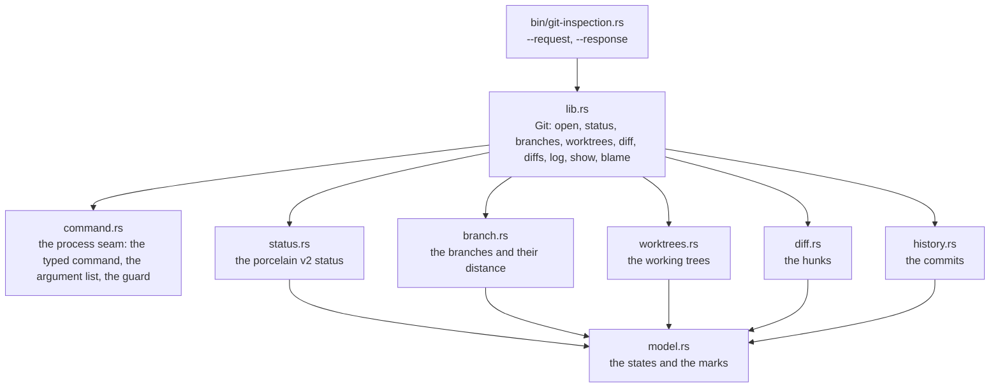

# The Git inspection layer

The one read-only model of a repository that the AIU text editor and the AIU terminal
multiplexer both read.

The layer owns the discovery, the commands, the parsing, the states and the freshness. It
owns no presentation: the two programs show what it says in their own ways, and they say
the same thing, because there is one model and one parser.

**It changes nothing.** It never stages, commits, checks out, merges, stashes, fetches,
pushes, or touches a worktree — and no command it can run would do any of those. A
change of state is a different program, with declared permissions.

## Purpose and boundaries

The problem it solves: two programs need to say what a repository holds, and they must
say the *same* thing. Two Git parsers means two meanings, and they drift.

This layer is the one place Git is asked and the one place its answers are turned into
states.

What belongs here:

- the repository discovery, the worktrees, the branches and the upstream;
- the working tree state, the index state, the divergence, the freshness;
- the diffs and the hunks, the history, the blame, a file at a commit;
- the process seam: the only way this layer runs Git.

What belongs elsewhere:

- the editor's buffer state is the editor's own, and it is compared against the file, not
  saved for Git to see;
- the multiplexer draws the model in its own panel, with its own keys;
- anything that changes a repository is a future workflow layer with explicit
  permissions, and it is not built here.

The design is in `plan/git-inspection.org`, and the decision is D-019 in the root
`../../DECISIONS.org`.

## The read-only boundary

The boundary is kept by construction, not by discipline:

- **The command is a typed choice.** `command::GitCommand` is an enum with a variant for
  each read: `Repository`, `Status`, `Worktrees`, `Branches`, `Log`, `Show`, `Diff`,
  `Blame`, `FileAt`. There is no variant for anything that writes, so a mutating Git
  command cannot even be spelled.
- **Structured arguments, always.** Every command is given as an argument list, and a
  path is one argument — a path with a space, a quote, a newline or a Unicode name in it
  stays one argument.
- **An explicit working directory**, and no shell anywhere: nothing is ever interpolated
  into a command line.
- **No command reaches a remote.** The counts of ahead and behind come from the refs
  that are here, so a branch whose upstream ref is missing is `Unknown` and never "up to
  date".
- **A guard on every command.** A command that overruns the wait is stopped, so a command
  that never ends cannot hold the program with it. The wait for the command itself ends
  when the command ends.

## Current status

| Capability | State |
|---|---|
| The repository discovery | Implemented and verified |
| The worktrees: the main one, the linked ones, the detached ones | Implemented and verified |
| The working tree state and the index state, apart | Implemented and verified |
| The branch, the upstream, the ahead and behind, the divergence | Implemented and verified |
| The diff of a file and the diff of a whole tree, file by file | Implemented and verified |
| The history, and the file at a commit | Implemented and verified |
| The blame | Implemented and verified |
| The freshness and the failure states | Implemented and verified |
| The one-shot program over a pair of files | Implemented and verified |
| The editor reads the layer | Planned: the layer is built, the editor does not read it yet |
| The multiplexer reads the layer | Planned: the layer is built, the multiplexer does not read it yet |
| The in-file indicators in the editor | Planned |
| The worktree overview in the multiplexer | Planned |
| Any mutating operation | Deliberately out of scope: a future workflow layer, with declared permissions |

## Architecture



Every module has one job: `command.rs` runs Git and nothing else, the parsers turn
output into the model, and `model.rs` holds the states and the marks. The parsers never
ask Git anything themselves, and the model never knows where the facts came from.

## The model

The states are separate on purpose, and none of them is collapsed into one "changed".

| State | The values |
|---|---|
| The working tree of a file | clean, modified, added, deleted, renamed, copied, untracked, type change, conflicted, unknown |
| The index of a file | unchanged, added, modified, deleted, renamed, copied, unmerged, unknown |
| The editor's buffer | saved, unsaved changes, unsaved changes over a Git change, not available |
| The head | on a branch, detached at a commit, a branch with no commit yet |
| The divergence | in step with the upstream, ahead, behind, diverged, the upstream is not known here |
| The freshness | fresh, being read, stale, the read failed, this Git does not have it |

Each state has a **name** and a **mark**: a reader with no colors still tells them apart.

| | added | modified | deleted | untracked | conflicted | staged | ahead | behind | unsaved |
|---|---|---|---|---|---|---|---|---|---|
| mark | `+` | `~` | `-` | `?` | `!` | `~` | `^` | `v` | `*` |

**The file changes and the unpushed commits are never conflated.** A changed file is not
an unpushed commit; a clean file on a branch with unpushed commits is clean; a branch can
be ahead and behind at once. The three dimensions are separate fields: the working tree,
the index, the editor's buffer, and the branch's distance from its upstream.

**The buffer is the editor's own.** A buffer can hold changes Git cannot see, because
they are not on disk. The layer never saves a buffer to find out.

## Public interface

The library:

```rust
let git = Git::open(path)?;                 // the repository at a path
let status = git.status();                  // what this worktree holds now
let status = git.status_at(&other_path);    // what that worktree holds
let branches = git.branches();              // the local branches and their distance
let worktrees = git.worktrees();            // every working tree of the repository
let repository = git.repository()?;         // the repository and its worktrees
let hunks = git.diff(Some("a.txt"), Comparison::WorkingVsIndex)?;
let files = git.diffs(Comparison::WorkingVsHead)?;  // the tree, file by file
let commits = git.log(Some("a.txt"))?;      // the history of a path
let commit = git.show("HEAD")?;             // one commit and the files it touched
let lines = git.blame("a.txt")?;            // the line history
let text = git.file_at("HEAD:a.txt")?;      // the contents at a commit
```

The comparisons are named and never mixed: `WorkingVsIndex`, `IndexVsHead`,
`WorkingVsHead`.

The one-shot program, for the editor's join seam:

```bash
git-inspection --request REQ.json --response ANS.json
```

| Op | What it answers |
|---|---|
| `status` | the status of the worktree: the head, the upstream, the divergence, the counts, the files |
| `branches` | the local branches, their upstream and their distance |
| `repository` | the repository, its directories and its worktrees |
| `worktrees` | every working tree, with its counts and its distance |
| `diff` | the diff of one comparison, file by file, with the hunks and the lines |
| `log` | the history, newest first |
| `show` | one commit: what it said and what it touched |
| `file-at` | the contents of a file at a commit |

The answer is the model's own data, so the editor and the multiplexer cannot disagree
about what Git said.

## The Git formats it reads

| What | The command and the format |
|---|---|
| Where the repository is | `rev-parse --path-format=absolute --show-toplevel --absolute-git-dir --git-common-dir` |
| The status | `status --porcelain=v2 -z --branch --untracked-files=all` |
| The worktrees | `worktree list --porcelain -z` |
| The branches | `for-each-ref` with a NUL-separated format, including `%(upstream:track)` |
| The history | `log --name-status -z` with a NUL-separated format |
| One commit | `show --name-status -z` |
| The diff | `diff --no-color --no-ext-diff --unified=0`, with `--cached` or `HEAD` for the other comparisons |
| The blame | `blame --line-porcelain --root` |
| A file at a commit | `show <commit>:<path>` |

Every command runs with `-c core.quotePath=false`, so a Unicode path is not escaped into
something unreadable. The NUL-delimited forms are used wherever Git offers them, so a
path with a newline in it stays one path.

## How it works

1. `Git::open` asks where the repository is and refuses, by name, when the path is not
   inside a working tree.
2. The status is read in the porcelain v2 format and turned into the model: the head, the
   upstream, the distance, and one entry per file with its index state and its working
   tree state apart.
3. The branches are read from the local refs, and the track string becomes the divergence.
   A branch with no upstream is `Unknown`.
4. The worktrees are read from the porcelain list, and each one's counts and distance are
   read in that worktree itself: a worktree is a place, and Git is asked there.
5. A diff is parsed into hunks, and the hunks carry the lines that changed and where they
   were and where they are.

## Usage

```bash
cd git-inspection
CARGO_TARGET_DIR=/tmp/opencode/git-target cargo build --offline
CARGO_TARGET_DIR=/tmp/opencode/git-target cargo test --offline
```

A request over the program:

```bash
cat > /tmp/git-request.json <<'JSON'
{ "op": "status", "path": "/root/home/shape/Subnet" }
JSON
/tmp/opencode/git-target/debug/git-inspection \
  --request /tmp/git-request.json --response /tmp/git-answer.json
cat /tmp/git-answer.json
```

## Configuration and compatibility

- Git 2.53.0 is what the layer was measured against, and it asks for nothing newer: the
  porcelain v2 status and the porcelain worktree list are both there.
- The phone's cargo registry cache holds `libc` and `serde_json`, and the layer needs
  only those.
- The layer does not read a configuration file of its own and honours the repository's
  `core.quotePath` only to make the paths readable.

## Dependencies and integration

- Rust, `libc` and `serde_json`, and nothing else.
- The multiplexer will link it in process; the editor will reach it over the join seam,
  the same shape as the workspace engine.
- The Git binary is the only external tool, and it is optional: a machine without Git
  gets a refusal that says so.

## Validation, invariants, and error handling

- **The inspection changes nothing.** A test builds a real repository, takes the state of
  HEAD, the refs, the status, the index bytes, the worktree list and the file list, runs
  every inspection, and compares all of it again.
- A path that is not a repository is refused by name, with Git's own words.
- A command that fails is not reported as an empty answer: the exit code, the error
  output and the output are kept apart, and the failure is a state of its own.
- An unknown upstream is `Unknown`, never "up to date", and never "behind".
- The path of a file with an unusual name stays one path, through the status, the diff
  and the history.

## Testing and verification

```bash
cd git-inspection
CARGO_TARGET_DIR=/tmp/opencode/git-target cargo test --offline
```

51 tests, green at the time of writing. They cover the parsers against the exact shapes
Git writes, and they build **real repositories** in a temporary directory for the states
that only real Git produces: a fresh repository, a modified file, a staged file, a file
that is both, an untracked file, a deleted file, a renamed file, a conflict, a linked
worktree, a detached worktree, a repository whose path holds spaces, a file whose name
holds spaces and quotes, the diff's added and removed lines, the history, and the safety
proof that the inspection changes nothing.

## Limitations

- Nothing reads the layer yet: the editor's indicators and the multiplexer's worktree
  overview are the next steps on their sides.
- The diff of a whole tree is parsed from the unified format, so the paths of the files
  come from the diff's own headers.
- The layer does not run `git fetch`, so a branch whose upstream ref is not here stays
  `Unknown` until something else brings the ref.
- A bare repository is not a working tree, and the layer says so rather than pretending.

## Roadmap

The layer is built and verified. What remains is on the two programs' sides: the editor's
in-file indicators, its diff views and its history; the multiplexer's worktree overview,
its changed-files and diff panels, and the keymap group; and, later, a workflow layer
that may act on a repository through explicit permissions, without this layer ever
growing a mutating command.

## Related documentation

- `plan/git-inspection.org` — the assessment of the two trees, the read-only boundary,
  the model, the worktrees, and the order the stages land in.
- `INDEX.org` — every file in this package, with its job.
- `src/INDEX.org` — the same for the code.
- `../../WORKSPACE.org` — the other shared package, and the pattern this one follows.
- `../../DECISIONS.org` — decision D-019, the Git integration.
- `../../contract/` — the contracts the two programs share.

## Development

```bash
cd git-inspection
CARGO_TARGET_DIR=/tmp/opencode/git-target cargo build --offline
CARGO_TARGET_DIR=/tmp/opencode/git-target cargo test --offline
```

The conventions are the ecosystem's: one file, one job, a name that says what the thing
does, a commit with explicit relative paths, and a commit that leaves the tree able to
load.
