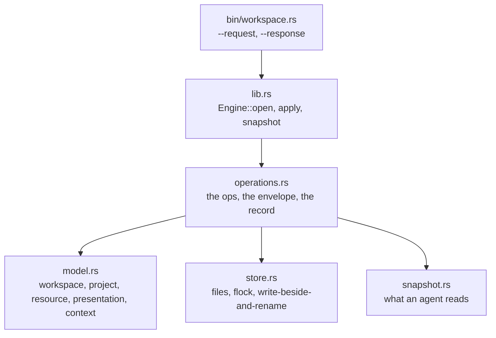

# The workspace engine

The one model and the one store that the AIU text editor and the AIU terminal multiplexer
both read and write.

The engine owns the workspace, the projects, the resource references, the presentations,
the shared context and the record of the operations that were carried out.

It owns **no** buffer, no terminal and no process. It is **not** a daemon: it has no
listener, no thread and no timer. It is a library, and a one-shot program that speaks
the same envelope over a pair of files.

## Purpose and boundaries

The problem it solves: the editor and the multiplexer are two programs, each with its own
idea of what the owner is working on. Without a shared model, the editor's project and
the multiplexer's project are two different facts, and an agent reading one of them is
reading half the truth.

The engine is the single place where that truth lives.

What belongs here:

- the workspace: its identity, its name, when it was created and changed;
- the projects: their roots, tags, commands, docs and settings;
- the resource references: a named thing with an owner, a kind, a location, a status and
  its capabilities;
- the presentations: the named groups of resources;
- the shared context: the project, the resources and the notes;
- the record of the operations, so a repeated request is answered from the record instead
  of being done twice.

What belongs elsewhere:

- the editor keeps its buffers, tabs and modes;
- the multiplexer keeps its tabs, panes and sessions;
- the resources themselves stay where they are: the engine holds **references** to them,
  not the things;
- the Git model belongs to the `../git-inspection` package.

The design is in `../../WORKSPACE.org`, and the words it obeys are frozen in four contracts:
`../../contract/workspace-model.org`, `../../contract/workspace-operations.org`,
`../../contract/workspace-mode-line.org` and `../../contract/workspace-ai-context.org`.

## Current status

| Capability | State |
|---|---|
| The model: workspace, project, resource reference, presentation, context | Implemented and verified |
| The store: files, one writer at a time, write-beside-and-rename | Implemented and verified |
| The operations, over one envelope | Implemented and verified |
| The record: a repeated request is answered from the record, never done twice | Implemented and verified |
| The snapshot for an agent | Implemented and verified |
| The one-shot program over a pair of files | Implemented and verified |
| The multiplexer reads and writes the workspace | Planned: the multiplexer's TODO item 16 |
| The editor reads and writes the workspace | Planned: the editor's TODO item 20 |
| The mode line of both programs naming the workspace and the project | Planned: the contract is frozen, the programs do not read it yet |
| The editor's resources reaching the engine as a mailbox | Planned: the contract is frozen |

## Architecture



The store is files in one state directory that is an argument. A write renames over the
old file, so a reader sees the old state or the new one and never a half-written one.
There is one writer at a time: the write holds a lock (`flock`) on the workspace's
directory, and the read takes no lock at all, because the rename makes it safe.

The operations travel in one envelope over two channels: the engine carries the workspace
state, the multiplexer's own socket carries its resources, and the editor's mailbox in
the engine carries the editor's resources. The envelope is the same everywhere, and the
key order is fixed.

## Public interface

The library:

```rust
let engine = Engine::open(state_dir)?;      // the engine, over one state directory
let answer = engine.apply(&request);        // one request in, one envelope out
let snapshot = engine.snapshot("workspace")?; // what an agent reads
let store = engine.store();                  // the store itself
```

The one-shot program, which is what the editor's join seam would call:

```bash
workspace --state-dir DIR --request REQ.json --response ANS.json
```

The request is one JSON object with the protocol, the request id, the op and the args;
the answer is one JSON object with the protocol, the request id, the op, the state, the
data and the reason.

The operations, by group:

| Group | Operations |
|---|---|
| Workspace | `workspace.list`, `workspace.create`, `workspace.read`, `workspace.rename`, `workspace.delete`, `workspace.validate` |
| Project | `project.register`, `project.list`, `project.read`, `project.rename`, `project.remove` |
| Resource | `resource.register`, `resource.update`, `resource.unregister`, `resource.list` |
| Context | `context.read`, `context.write` |
| Presentation | `presentation.create`, `presentation.list`, `presentation.delete` |
| Reporting | `application.report`, `snapshot` |

A mutating operation carries a request id, and a repeat of the same request id is
answered from the record: the change is done once, never twice.

## How it works

1. A request arrives: one JSON object with the op, the request id and the args.
2. If the op mutates, the record is checked first: a request id that was already carried
   out is answered from the record, so nothing happens twice.
3. The operation reads and writes the store, under the one-writer lock, and the new state
   is written beside the old one and renamed over it.
4. The answer is the one envelope: the protocol, the request id, the op, the state
   (`completed` or the refusal's state), the data and the reason.
5. A refusal is loud: it names what was rejected and why, and it carries the state, so a
   reader never has to guess whether something happened.

## Usage

```bash
cd workspace
CARGO_TARGET_DIR=/tmp/opencode/ws-target cargo build --offline
CARGO_TARGET_DIR=/tmp/opencode/ws-target cargo test --offline
```

A request over the program:

```bash
cat > /tmp/ws-request.json <<'JSON'
{ "protocol": "workspace/1", "request": "r-1", "op": "workspace.list", "args": {} }
JSON
/tmp/opencode/ws-target/debug/workspace \
  --state-dir /tmp/ws-state --request /tmp/ws-request.json --response /tmp/ws-answer.json
cat /tmp/ws-answer.json
```

## Configuration and compatibility

- The state directory is an argument, never a fixed path: one environment, one store.
- The protocol version is in the envelope, so a reader knows which shape it got.
- The model and the operations are frozen in the four workspace contracts; a change to
  them goes through the root decision log (`../../DECISIONS.org`, D-018).

## Dependencies and integration

- Rust, `libc` and `serde_json`, and nothing else.
- The multiplexer links it in process; the editor reaches it over the join seam, the
  pattern the workspace engine was designed for.
- The Git model is a separate package, `../git-inspection`, with the same rule: one
  meaning, one parser.

## Validation, invariants, and error handling

- A write is atomic: the new state is written beside the old one and renamed over it.
- One writer at a time: the write holds the lock, the read does not need it.
- A repeated request id is answered from the record, never carried out twice.
- Every answer is the same envelope with the same key order.
- A refusal names what was rejected and why, and it says so in the answer, not in a
  log line nobody reads.

## Testing and verification

```bash
cd workspace
CARGO_TARGET_DIR=/tmp/opencode/ws-target cargo test --offline
```

20 tests, green at the time of writing, and a phone end-to-end run of the program over a
real request file.

What is not verified: the two programs reading the engine, because neither does it yet.

## Limitations

- Nothing reads the engine from the editor or the multiplexer yet; the integration is
  the next step on both sides.
- The store is a directory of files, not a database: it is meant to be read, copied and
  inspected by a person.
- The engine holds references to resources, not the resources; a resource that has moved
  is the owner's problem to fix, and the engine records the reference as it is.

## Roadmap

The engine is built. What remains is on the two programs' sides: the multiplexer reading
and writing the workspace and naming it in its mode line (the multiplexer's TODO item
16), and the editor doing the same (the editor's TODO item 20). The contracts for both
are already frozen, so the work is the reading and the writing, not the design.

## Related documentation

- `../../WORKSPACE.org` — the shared workspace architecture: the audit of the two programs,
  the boundaries, where the engine lives, and the order the work lands in.
- `../../contract/workspace-model.org` — the model.
- `../../contract/workspace-operations.org` — the operations and the envelope.
- `../../contract/workspace-mode-line.org` — what the mode lines of both programs show.
- `../../contract/workspace-ai-context.org` — what an agent reads.
- `INDEX.org` — every file in this package, with its job.
- `src/INDEX.org` — the same for the code.
- `../../DECISIONS.org` — decision D-018, the shared workspace.

## Development

```bash
cd workspace
CARGO_TARGET_DIR=/tmp/opencode/ws-target cargo build --offline
CARGO_TARGET_DIR=/tmp/opencode/ws-target cargo test --offline
```

The conventions are the ecosystem's: one file, one job, a name that says what the thing
does, a commit with explicit relative paths, and a commit that leaves the tree able to
load.
